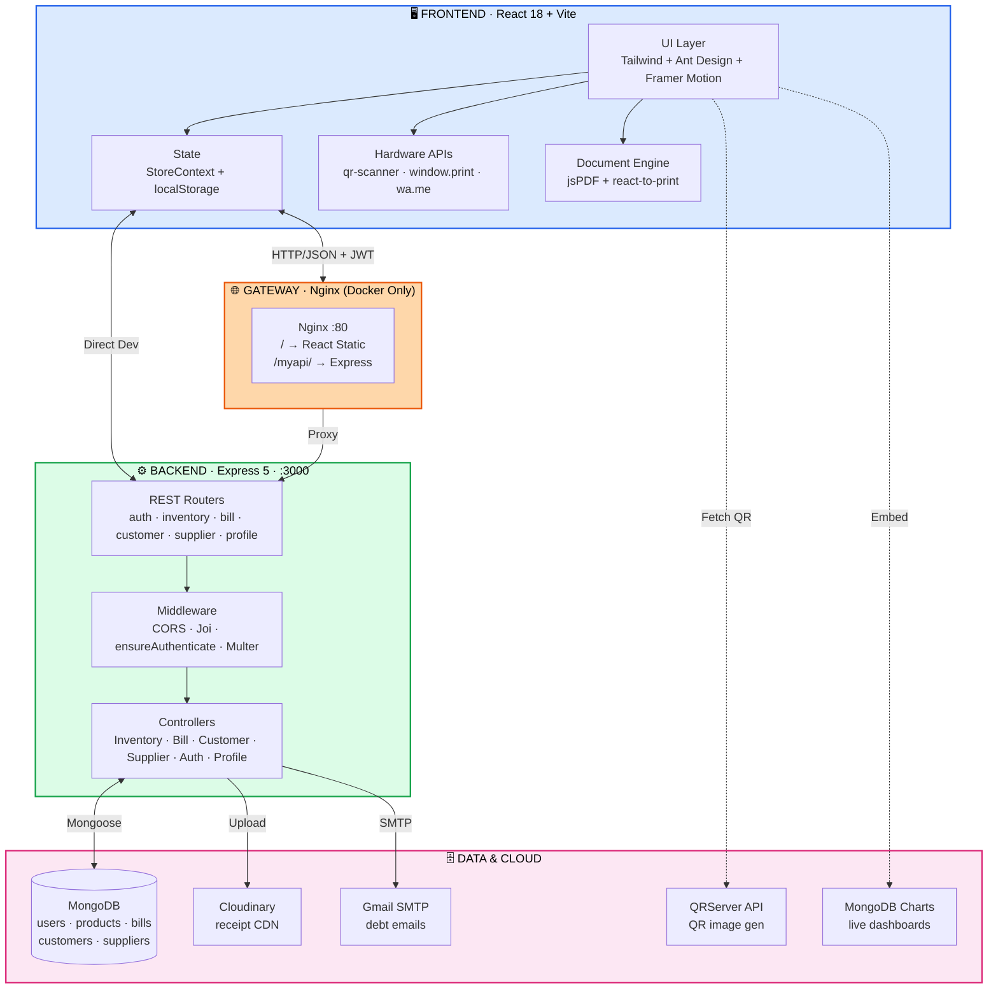
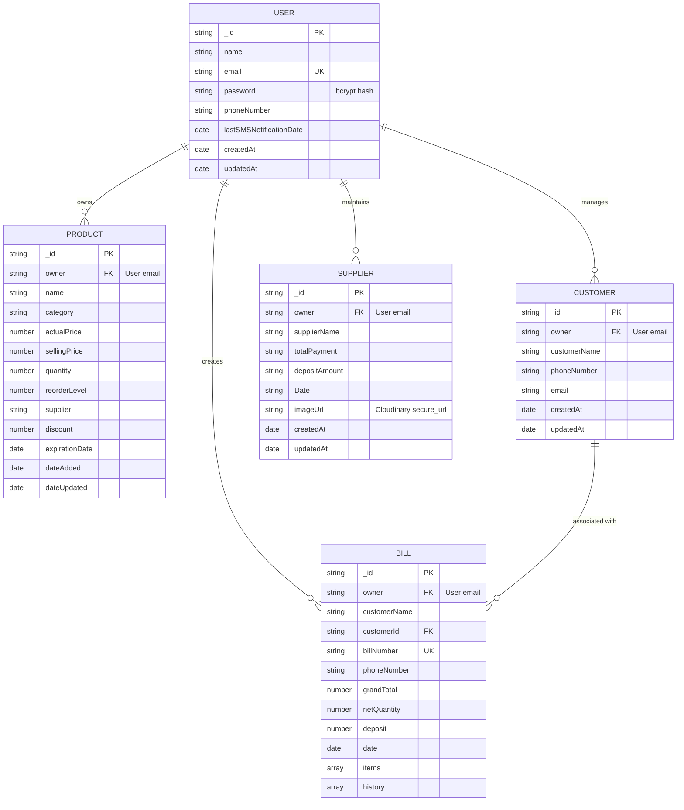

<!-- ═══════════════════════════════════════════════════════════════════════════
     SHOPMANAGER · Retail Operations System
     POS · Inventory · Credit Ledger · Analytics
     ═══════════════════════════════════════════════════════════════════════════ -->

<div align="center">

```
                                    ╭──────────────────╮
                                    │  ▓ SCAN · LIVE   │
                                    ╰────────┬─────────╯
                                             │
   ╭─────────────────────────────────────────┴───────────────────────────╮
   │                                                                     │
   │     ███████╗██╗  ██╗ ██████╗ ██████╗     ███╗   ███╗ ██████╗ ██████╗ │
   │     ██╔════╝██║  ██║██╔═══██╗██╔══██╗    ████╗ ████║██╔════╝ ██╔══██╗│
   │     ███████╗███████║██║   ██║██████╔╝    ██╔████╔██║██║  ███╗██████╔╝│
   │     ╚════██║██╔══██║██║   ██║██╔═══╝     ██║╚██╔╝██║██║   ██║██╔══██╗│
   │     ███████║██║  ██║╚██████╔╝██║         ██║ ╚═╝ ██║╚██████╔╝██║  ██║│
   │     ╚══════╝╚═╝  ╚═╝ ╚═════╝ ╚═╝         ╚═╝     ╚═╝ ╚═════╝ ╚═╝  ╚═╝│
   │                                                                     │
   │              ╾ R E T A I L   O P E R A T I O N S ╼                  │
   │                                                                     │
   ╰─────────────────────────────────────────────────────────────────────╯
```

# 🛒 ShopManager

### Smart Inventory · Retail POS · Customer Credit Ledger

**For the shopkeepers who still write in notebooks.**

<br>

[](https://react.dev/)
[](https://vitejs.dev/)
[](https://nodejs.org/)
[](https://expressjs.com/)

[](https://www.mongodb.com/)
[](https://tailwindcss.com/)
[](https://www.docker.com/)
[](https://vercel.com/)

<br>

[](https://smart-inventory-management-system-frontend.vercel.app/)
&nbsp;
[](#-system-architecture)
&nbsp;
[](#-api-reference)

</div>

---

<div align="center">

```
        ┌─────────┐    ┌─────────┐    ┌─────────┐    ┌─────────┐
        │  INVENT │ →  │  SCAN   │ →  │  BILL   │ →  │  LEDGER │
        └─────────┘    └─────────┘    └─────────┘    └─────────┘
             ↓              ↓              ↓              ↓
        ┌─────────────────────────────────────────────────────┐
        │  ▣  8 MongoDB Charts   ▣  WhatsApp   ▣  PDF   ▣   │
        └─────────────────────────────────────────────────────┘
```

</div>

---

## 📖 Table of Contents

<table>
<tr>
<td valign="top" width="33%">

### 🏪 **Product**
- [Overview](#-overview)
- [Features](#-key-features)
- [Screenshots](#-screenshots--visual-tour)

### 🧱 **Engineering**
- [Tech Stack](#-technology-stack)
- [Architecture](#-system-architecture)
- [Repo Layout](#-repository-structure)

</td>
<td valign="top" width="33%">

### 🚀 **Deploy**
- [Prerequisites](#-prerequisites)
- [Installation](#-installation--setup)
- [Environment](#-environment-variables)
- [Running](#-running-the-application)

### 🎯 **Usage**
- [Walkthrough](#-user-walkthrough)
- [API Reference](#-api-reference)
- [Data Models](#-database--data-models)

</td>
<td valign="top" width="33%">

### 🛡️ **Operations**
- [Testing](#-testing--code-quality)
- [Deployment](#-deployment-configuration)
- [Security](#-security--privacy-considerations)

### 📚 **Reference**
- [Troubleshooting](#-troubleshooting--faq)
- [Roadmap](#-roadmap)
- [Contributing](#-contributing)

</td>
</tr>
</table>

---

## 🎯 Overview

### The Problem

<div align="center">

```
   ┌──────────────────────────┐   ┌──────────────────────────┐
   │  📓  PAPER KHATA          │   │  🐢  SLOW CHECKOUT        │
   │  Lost · damaged · fought  │   │  Manual price lookup      │
   └──────────────────────────┘   └──────────────────────────┘
   ┌──────────────────────────┐   ┌──────────────────────────┐
   │  📦  SILENT STOCKOUTS     │   │  🧾  LOST INVOICES        │
   │  Expiry unnoticed         │   │  No payable tracking      │
   └──────────────────────────┘   └──────────────────────────┘
   ┌──────────────────────────────────────────────────────────┐
   │  💸  ENTERPRISE POS = ₹5,000+ / year · proprietary HW    │
   └──────────────────────────────────────────────────────────┘
```

</div>

### The Solution

<table>
<tr>
<td width="50%" align="center" valign="top">

#### 😩 **BEFORE**

<sub>Paper · Manual · Fragmented · Expensive</sub>

```
  📓  Notebook khata
  🔍  Memorized prices
  📦  Unknown stock status
  🧾  Scattered invoices
  💸  ₹5,000+ subscriptions
  🖥️  Desktop-bound
```

</td>
<td width="50%" align="center" valign="top">

#### 🚀 **AFTER**

<sub>Digital · QR · Unified · Free</sub>

```
  💾  Digital credit ledger
  📷  Camera QR scan
  🚦  Auto stock badges
  ☁️  Cloud receipt archive
  🎉  ₹0 · browser only
  📱  Any device
```

</td>
</tr>
</table>

> **ShopManager** collapses the POS terminal, QR inventory system, customer khata ledger, supplier tracking, and analytics dashboard into **one mobile-friendly SPA**. Your phone becomes a complete retail management station.

### Target Audience

| 👤 | Who | Why |
|:--:|:---|:---|
| 🏪 | **Kirana & General Stores** | Replace paper khata with digital ledger |
| 🔧 | **Hardware & Apparel Shops** | Fast camera-based checkout at peak hours |
| 📱 | **Small Electronics Retailers** | Track serial inventory + supplier payables |
| 🧑‍💻 | **Technical Reviewers** | Full-stack MERN + transactional DB + hardware APIs |

---

## ⚙️ Key Features

<div align="center">

### `━━━━━━━━━━━━━━━` 01 · POS Terminal  `━━━━━━━━━━━━━━━`

</div>

<table>
<tr>
<td width="45%" valign="top" align="center">

#### 🎥 **Scan**
```
  ╭─────────────╮
  │  ▓ ▓ ░ ▓ ▓  │
  │  ░ ▓ ▓ ░ ▓  │  ← hold QR to camera
  │  ▓ ░ ▓ ▓ ░  │
  ╰─────────────╯
   live · qr-scanner
```

</td>
<td width="55%" valign="top">

#### 🧾 **Cart**

```
  Dettol 250ml        × 2    ₹ 190.00
  Maggi 12-pack       × 1    ₹ 144.00
  Colgate Strong      × 3    ₹ 153.00
  ────────────────────────────────────
  Subtotal                   ₹ 487.00
  Discount (5%)             −₹  24.35
  ────────────────────────────────────
  TOTAL                      ₹ 462.65
```

</td>
</tr>
</table>

| 🎯 Capability | ⚙️ Powered By |
|:---|:---|
| 🎥 Live QR / barcode scanning | `qr-scanner` (device camera) |
| 🧮 Dynamic cart math | Subtotal · % discount · net qty |
| 📦 Atomic stock decrement | Same MongoDB workflow as checkout |
| 💰 Split payment / credit deposit | Unpaid → customer ledger |
| 🖨️ Instant receipts | `react-to-print` · thermal / A4 |
| 📄 Vector PDF export | `jspdf` |
| 📱 WhatsApp invoice delivery | `wa.me` Click-to-Chat |

---

<div align="center">

### `━━━━━━━━━━━━━━━` 02 · Inventory & Stock  `━━━━━━━━━━━━━━━`

</div>

<table>
<tr>
<td width="25%" align="center">

#### ✅ IN STOCK
```
  Parle-G
  ────────
  ₹10 · Qty 240
```

</td>
<td width="25%" align="center">

#### ⚠️ LOW STOCK
```
  Amul Butter
  ────────
  ₹58 · Qty 8 ⚠
```

</td>
<td width="25%" align="center">

#### 🔴 OUT
```
  Tata Salt
  ────────
  ₹34 · Qty 0
```

</td>
<td width="25%" align="center">

#### ⏰ EXPIRING
```
  Cadbury Dairy Milk
  ────────
  exp 22 days 🟡
```

</td>
</tr>
</table>

| ✨ Feature | 📝 Detail |
|:---|:---|
| 📋 **Product catalog** | Name · category · cost · selling · qty · reorder level · supplier · discount · expiry |
| 🔳 **QR generation** | Auto-generated via `api.qrserver.com` — printable for shelf / packaging |
| 🚦 **Health badges** | ✅ In Stock · ⚠️ Low (≤ reorder) · 🔴 Out |
| ⏳ **Expiry tracking** | 🟢 Fresh · 🟡 Expiring ≤ 30d · 🔴 Expired |
| ⚡ **Inline edits** | Update qty · cost · selling without re-creating |

---

<div align="center">

### `━━━━━━━━━━━━━━━` 03 · Digital Khata  `━━━━━━━━━━━━━━━`

</div>

> *Replaces the notebook — permanently.*

<table>
<tr>
<td width="55%" valign="top">

```
   ╭─── LEDGER · Ramesh Kirana ─────────────────╮
   │                                            │
   │   Lifetime purchases    ₹ 47,850.00        │
   │   Total paid            ₹ 42,500.00        │
   │   ────────────────────────────────────     │
   │   OUTSTANDING           ₹  5,350.00        │
   │   ⚠ 18 days overdue                        │
   │                                            │
   │   Repayments:                              │
   │     12-Oct  ₹ 2,000  · Cash                │
   │     05-Oct  ₹ 1,500  · UPI                 │
   │     28-Sep  ₹ 3,500  · Cash                │
   │                                            │
   ╰────────────────────────────────────────────╯
```

</td>
<td width="45%" valign="top">

#### Actions

```
  ╭──────────────────────────────╮
  │  📧 Send Email Reminder      │
  ├──────────────────────────────┤
  │  💬 WhatsApp Nudge           │
  ├──────────────────────────────┤
  │  💰 Log Repayment            │
  ├──────────────────────────────┤
  │  📄 View Bill History        │
  ╰──────────────────────────────╯
```

</td>
</tr>
</table>

| ✨ Feature | ⚙️ Stack |
|:---|:---|
| 👤 **Customer directory** | Name · phone · email · lifetime value |
| 📊 **Auto-aggregated balance** | Purchases − deposits = net outstanding |
| 📝 **Repayment log** | Timestamp · amount · method (Cash / Card / UPI) |
| 📧 **Batch overdue reminders** | `nodemailer` · HTML emails · configurable threshold |
| 💬 **One-click WhatsApp** | Pre-filled message via `wa.me` |

---

<div align="center">

### `━━━━━━━━━━━━━━━` 04 · Supplier Ledger  `━━━━━━━━━━━━━━━`

</div>

<table>
<tr>
<td width="60%" valign="top">

```
   ╭─── VENDOR ACCOUNTS ─────────────────────────────────────╮
   │                                                         │
   │   Distributor         Date     Owing           Invoice  │
   │   ─────────────────────────────────────────────────     │
   │   Sharma Wholesale   14-Oct   ₹ 17,000    📎            │
   │   Krishna Traders    12-Oct   ₹      0    📎            │
   │   Patel Distributor  09-Oct   ₹ 26,200    📎            │
   │                                                         │
   ╰─────────────────────────────────────────────────────────╯
```

</td>
<td width="40%" valign="top">

#### Capabilities

- 📸 **Cloud invoice archival** — JPEG/PNG · 5 MB cap
- 💰 **Outstanding payable tracking** per vendor
- 🗓️ **Invoice date audit** for reconciliation
- 🔗 **Cloudinary CDN** — receipts accessible anywhere

</td>
</tr>
</table>

---

<div align="center">

### `━━━━━━━━━━━━━━━` 05 · Visual Analytics  `━━━━━━━━━━━━━━━`

</div>

> *8 live dashboards powered by MongoDB Charts · auto-refresh every 5 minutes.*

<table>
<tr>
<td width="50%" align="top">

```
  ┌─ Stock Levels vs Reorder ──────────┐
  │  ▁▂▃▅▇█▇▅▃▂▁▂▃▅▇                  │
  └────────────────────────────────────┘

  ┌─ Top-Selling Products ─────────────┐
  │  ████████████████ Maggi            │
  │  ████████████     Parle-G          │
  │  ██████           Amul             │
  └────────────────────────────────────┘

  ┌─ Total Sales / Day ────────────────┐
  │  ▂▃▅▇█▇▅▃▂ ▂▃▅▇█▇▅▃▂              │
  └────────────────────────────────────┘

  ┌─ Average Txn / Month ──────────────┐
  │  ▆▇█▇▆▅▆▇█▇▆▅▆▇█▇▆▅              │
  └────────────────────────────────────┘
```

</td>
<td width="50%" align="top">

```
  ┌─ Product Sales Volume ─────────────┐
  │  ████████ ██████ ████ ██ █         │
  └────────────────────────────────────┘

  ┌─ Expiration Monitoring ────────────┐
  │  🟢 342    🟡 28    🔴 4           │
  └────────────────────────────────────┘

  ┌─ Stock Status Overview ────────────┐
  │  ✅ 289   ⚠️ 42   🔴 15            │
  └────────────────────────────────────┘

  ┌─ Total Quantity Sold ──────────────┐
  │  1,247 units this month            │
  └────────────────────────────────────┘
```

</td>
</tr>
</table>

Plus 🗓️ **interactive invoice calendar** — filter by day / month with daily revenue summary.

---

<div align="center">

### `━━━━━━━━━━━━━━━` 06 · Operational Scratchpad  `━━━━━━━━━━━━━━━`

</div>

<div align="center">

```
   ╭────────────────────────────────────────────────╮
   │  📝  NOTES                                     │
   ├────────────────────────────────────────────────┤
   │                                                │
   │  ▸ Return requested — Amul Butter batch A42   │
   │  ▸ Reorder: Parle-G (qty down to 12)          │
   │  ▸ Handover: shift change 6pm                 │
   │  ▸ Call Krishna Traders re: invoice mismatch  │
   │                                                │
   ╰────────────────────────────────────────────────╯
        💾 persisted to localStorage
```

</div>

---

## 📸 Screenshots · Visual Tour

<table>
<tr>
<td width="50%" align="center">

#### 🛒 POS Terminal


<sub>Live camera scan · dynamic cart · one-click receipt</sub>

</td>
<td width="50%" align="center">

#### 📦 Product Catalog


<sub>Stock + expiry badges · inline edits · QR print</sub>

</td>
</tr>
<tr>
<td width="50%" align="center">

#### ➕ Add Product


<sub>Full metadata intake · supplier · expiry date</sub>

</td>
<td width="50%" align="center">

#### 📊 Sales Analytics


<sub>Live MongoDB Charts · auto-refresh dashboard</sub>

</td>
</tr>
<tr>
<td colspan="2" align="center">

#### 🧾 Invoice Archive


<sub>Calendar-filtered invoice history · daily revenue aggregation</sub>

</td>
</tr>
</table>

---

## 🛠️ Technology Stack

<table>
<tr>
<td valign="top" width="33%">

### ⚛️ Frontend

| Tech | Version |
|:---|:---|
| React | `18.3.1` |
| Vite | `6.2.5` |
| Tailwind CSS | `3.4.13` |
| React Router DOM | `6.26.2` |
| Context API | *native* |
| Axios | `1.7.7` |
| Ant Design | `5.24.6` |
| Framer Motion | `12.6.3` |
| Lucide + React Icons | `0.487` · `5.5` |
| QR Scanner | `1.4.2` |
| jsPDF | `3.0.1` |
| React-To-Print | `3.0.1` |
| React Datepicker | `8.3.0` |
| MongoDB Charts SDK | `3.3.1` |
| React Toastify | `10.0.5` |

</td>
<td valign="top" width="33%">

### ⚙️ Backend

| Tech | Version |
|:---|:---|
| Node.js | `18.x` · `20.x` |
| Express.js | `5.1.0` |
| Mongoose | `8.13.2` |
| jsonwebtoken | `9.0.2` |
| bcrypt | `5.1.1` |
| Joi | `17.13.3` |
| Multer | `1.4.5-lts.2` |
| Cloudinary SDK | `2.6.0` |
| Nodemailer | `7.0.9` |
| CORS | `2.8.5` |
| dotenv | `16.4.7` |

</td>
<td valign="top" width="33%">

### 🏗️ Infrastructure

| Tech | Role |
|:---|:---|
| Docker | Multi-stage container builds |
| Nginx Alpine | Reverse proxy · static server |
| Docker Compose | Multi-container bridge |
| Vercel | Serverless + SPA hosting |

### ☁️ Cloud Services

| Service | Role |
|:---|:---|
| MongoDB Atlas | Primary datastore |
| Cloudinary | Receipt image CDN |
| Gmail SMTP | Nodemailer transport |
| QRServer API | QR image generation |
| MongoDB Charts | Embedded analytics |

</td>
</tr>
</table>

---

## 🏛️ System Architecture



### 🔒 Multi-Tenant Data Isolation

Every core document (`Product` · `Bill` · `Customer` · `Supplier`) carries an `owner` field populated from the verified JWT:

```javascript
const documents = await Product.find({ owner: req.user.email });
//                                    ▲
//                                    └── every read/write scoped to merchant
```

**Store A can never see Store B's data** — enforced at the query layer, not the UI.

---

## 📂 Repository Structure

```text
ShopManager-Smart-Inventory-Management-App/
│
├── 🐳 docker-compose.yml              Multi-container: Nginx + Backend
├── 🐳 dockerfile                      Multi-stage React → Nginx runtime
├── 📖 readme.md
│
├── 🌐 Nginx/
│   └── default.conf                   / → React  ·  /myapi/ → Express
│
├── ⚙️ backend/                        ── Express REST API ──
│   ├── server.js                      Bootstrap · middleware · routes
│   ├── vercel.json                    Serverless deploy descriptor
│   ├── dockerfile                     Two-stage Node container
│   ├── config/
│   │   └── cloudinary.js              SDK config + upload helper
│   ├── controllers/
│   │   ├── AuthController.js          signup (bcrypt) · login (JWT)
│   │   ├── BillController.js          POS bill · stock decrement · history
│   │   ├── CustomerController.js      Customer CRUD + batch email reminders
│   │   ├── dbController.js            Mongoose connection
│   │   ├── InventoryController.js     Product CRUD + search
│   │   ├── ProductController.js       Read-only product list
│   │   ├── ProfileController.js       Store/user profile
│   │   └── SupplierController.js      Supplier + Cloudinary upload
│   ├── Middleware/
│   │   ├── auth.js                    ensureAuthenticate · JWT verify
│   │   ├── AuthValidation.js          Joi rules (signup · login)
│   │   └── multer.js                  5 MB cap · image-only
│   ├── models/
│   │   ├── Bill.js                    Line items · deposits · history
│   │   ├── Customer.js                Contact info
│   │   ├── Product.js                 Pricing · stock · supplier · expiry
│   │   ├── supplier.js                Dues · Cloudinary URL
│   │   └── User.js                    Password toJSON strip
│   └── routes/
│       ├── authRoutes.js              /sign-up · /login
│       ├── billRoutes.js              /create · /getbill · /update/:id
│       ├── customerRoutes.js          /add · /all · /send-reminders
│       ├── inventoryRoutes.js         /add · /list · /update · /delete
│       ├── productRoutes.js           /products
│       ├── profileRoutes.js           /profile · /manage-profile
│       └── supplierRoutes.js          /supplier-data · /suppliers
│
└── 🖥️ Frontend/                        ── React 18 + Vite SPA ──
    ├── index.html
    ├── vercel.json                    SPA rewrite rules
    ├── vite.config.js
    ├── tailwind.config.js
    ├── postcss.config.js
    ├── eslint.config.js
    ├── public/
    │   ├── addproduct.png
    │   ├── billgen.png
    │   ├── logo.gif
    │   ├── productlist.png
    │   ├── sales.png
    │   └── showbill.png
    └── src/
        ├── App.jsx                    Routes + PrivateRoute gate
        ├── main.jsx                   React DOM root
        ├── utils.js                   Toastify helpers
        ├── Context/
        │   └── StoreContext.jsx       Auth · bills · customers global store
        └── component/
            ├── billgenerator.jsx      POS screen + camera scanner
            ├── dashboard.jsx          Merchant dashboard
            ├── inventorymanager.jsx   CRUD + QR generation
            ├── ProductList.jsx        Catalog + stock/expiry filters
            ├── CustomerAccount.jsx    Credit ledger overview
            ├── CustomerHistory.jsx    Per-customer ledger + repay modal
            ├── SupplierData.jsx       Vendor ledger + receipt upload
            ├── StockAnalysis.jsx      Embedded MongoDB Charts
            ├── ShowBill.jsx           Invoice archive + calendar
            ├── Notes.jsx              localStorage scratchpad
            ├── login.jsx / signup.jsx
            ├── navbar.jsx / footer.jsx
            └── profile.jsx
```

---

## 📋 Prerequisites

<table>
<tr>
<td width="50%" valign="top">

### ✅ Required

| | Item | Version |
|:--:|:---|:---|
| 📦 | **Node.js** | `v18.x` / `v20.x` (LTS · tested to v24) |
| 📦 | **npm** | `v9.x+` |
| 🗄️ | **MongoDB** | Local `:27017` or Atlas URI |
| 🌐 | **Browser** | Chrome · Firefox · Edge · Safari |
| 📷 | **Camera permission** | Required for QR scan |

</td>
<td width="50%" valign="top">

### ⚙️ Optional

| | Item | Why |
|:--:|:---|:---|
| 📧 | **Gmail + App Password** | Debt reminder emails |
| ☁️ | **Cloudinary account** | Supplier receipt CDN |
| 🐳 | **Docker + Compose** | Containerized deploy |

</td>
</tr>
</table>

---

## ⚙️ Installation & Setup

### `» 01` — Clone

```bash
git clone https://github.com/yash-shende99/ShopManager-Smart-Inventory-Management-App.git
cd ShopManager-Smart-Inventory-Management-App
```

### `» 02` — Configure Backend

```bash
cd backend
npm install
```

Create `backend/.env`:

```env
PORT=3000
MONGO_URL=mongodb+srv://<user>:<pass>@cluster0.mongodb.net/shopmanager?retryWrites=true&w=majority
JWT_SECRET=your_super_secret_jwt_key_min_32_characters

# Optional — email reminders
EMAIL_USER=your_store_email@gmail.com
EMAIL_PASS=your_16_character_gmail_app_password

# Optional — Cloudinary receipt uploads
CLOUDINARY_NAME=your_cloudinary_cloud_name
CLOUDINARY_API_KEY=your_cloudinary_api_key
CLOUDINARY_API_SECRET=your_cloudinary_api_secret
```

> 🪟 Windows: `New-Item -ItemType File -Name .env` &nbsp;·&nbsp; 🐧 Linux/macOS: `touch .env`

### `» 03` — Configure Frontend

```bash
cd ../Frontend
npm install
```

> 💡 **Dev default:** `StoreContext.jsx` points to `http://localhost:3000`. Ensure backend runs on port `3000`.

---

## 🔐 Environment Variables

<div align="center">

**`backend/.env`**

</div>

| 🔑 Variable | ✅ Req | 🎯 Default | 📝 Purpose |
|:---|:--:|:---|:---|
| `PORT` | ○ | `3000` | Express listen port |
| `MONGO_URL` | ✅ | — | MongoDB connection URI |
| `JWT_SECRET` | ✅ | — | JWT signing key |
| `EMAIL_USER` | ○ | — | Gmail address for Nodemailer |
| `EMAIL_PASS` | ○ | — | Gmail 16-char App Password |
| `CLOUDINARY_NAME` | ○ | — | Cloudinary cloud name |
| `CLOUDINARY_API_KEY` | ○ | — | Cloudinary API key |
| `CLOUDINARY_API_SECRET` | ○ | — | Cloudinary API secret |

> [!CAUTION]
> 🚨 **Never commit `backend/.env`.** Add it to `.gitignore`. Rotate any leaked keys immediately.

---

## 🏃 Running the Application

### ▸ Local Development

<table>
<tr>
<td width="50%" valign="top">

#### Terminal 1 · Backend

```bash
cd backend
npm run server     # nodemon
# or
npm start          # plain node
```

**Expected:**
```
server listening on port 3000
mongodb connected successfully
```

</td>
<td width="50%" valign="top">

#### Terminal 2 · Frontend

```bash
cd Frontend
npm run dev
```

**Expected:**
```
VITE v6.2.5 ready
→ http://localhost:5173/
```

</td>
</tr>
</table>

**🌐 Open:** [http://localhost:5173](http://localhost:5173)

### ▸ Docker Compose

```bash
docker compose up --build
```

| 🌐 Service | 🔗 URL |
|:---|:---|
| Frontend + Proxy | `http://localhost:80` |
| Nginx routes `/` | → React static bundle |
| Nginx routes `/myapi/` | → `backend:3000` (internal) |

Stop: `docker compose down`

---

## 📖 User Walkthrough

<div align="center">

```
   ┌───────┐    ┌───────┐    ┌───────┐    ┌───────┐    ┌───────┐    ┌───────┐
   │   ①   │ →  │   ②   │ →  │   ③   │ →  │   ④   │ →  │   ⑤   │ →  │   ⑥   │
   ├───────┤    ├───────┤    ├───────┤    ├───────┤    ├───────┤    ├───────┤
   │ Sign  │    │Populate│   │ Print │    │  POS  │    │Manage │    │Review │
   │  up   │    │catalog│    │  QR   │    │ scan  │    │ khata │    │analyt.│
   └───────┘    └───────┘    └───────┘    └───────┘    └───────┘    └───────┘
```

</div>

**`①`** **Merchant Onboarding** — Register at `/signup` → login at `/login` → 24h JWT stored in `localStorage`.

**`②`** **Catalog Creation** — Open **Inventory Manager** → **Add Product** → name · category · cost · selling · qty · reorder · supplier · expiry.

**`③`** **Print QR Labels** — Click the **QR icon** → auto-generated → **Print QR Code** for shelf / packaging.

**`④`** **POS Billing** — Open **Bill Generator** → **Start Scanner** → hold product QR to camera → auto-added. Enter customer + deposit (or leave blank for full payment) → **Create Bill**.
→ **Save as PDF** or **Share via WhatsApp**.

**`⑤`** **Khata Management** — Open **Customer Accounts** → view outstanding balances → **View History** for itemized unpaid bills → **Update Deposit** on repayment → **Send Reminders** with day threshold fires batch HTML emails.

**`⑥`** **Supplier Ledger** — Open **Supplier Data** → log deliveries · payables · deposits · attach photo scan → uploaded to Cloudinary.

**`⑦`** **Analytics** — Open **Stock Analysis** → 8 live MongoDB Charts panels.

---

## 📡 API Reference

> **Auth header:** `Authorization: <jwt_token>`

<details>
<summary><b>🔑 Auth</b> — <code>/api</code></summary>

<br>

| Method | Endpoint | Auth | Payload | Response |
|:---:|:---|:--:|:---|:---|
| `POST` | `/api/sign-up` | ❌ | `{ name, email, password, phoneNumber }` | `200 OK` |
| `POST` | `/api/login` | ❌ | `{ email, password }` | `{ jwttoken, email, name }` |

</details>

<details>
<summary><b>👤 Profile</b> — <code>/api</code></summary>

<br>

| Method | Endpoint | Auth | Payload | Response |
|:---:|:---|:--:|:---|:---|
| `GET` | `/api/profile` | ✅ | — | `{ user: { name, email, phoneNumber } }` |
| `POST` | `/api/manage-profile` | ✅ | `{ phoneNumber, businessName }` | `200 OK` |

</details>

<details>
<summary><b>📦 Inventory</b> — <code>/api/inventory</code> · <code>/api</code></summary>

<br>

| Method | Endpoint | Auth | Payload / Query |
|:---:|:---|:--:|:---|
| `POST` | `/api/inventory/add` | ✅ | Product JSON |
| `GET` | `/api/inventory/list?search=` | ✅ | Optional regex term |
| `PUT` | `/api/inventory/update-product/:id` | ✅ | `{ quantity, actualPrice, sellingPrice }` |
| `DELETE` | `/api/inventory/delete/:id` | ✅ | — |
| `GET` | `/api/products` | ✅ | — |

</details>

<details>
<summary><b>🧾 Billing & POS</b> — <code>/api/bill</code></summary>

<br>

| Method | Endpoint | Auth | Payload |
|:---:|:---|:--:|:---|
| `POST` | `/api/bill/create` | ✅ | `{ customerName, phoneNumber, deposit, customerId, items }` |
| `GET` | `/api/bill/getbill` | ✅ | — |
| `PUT` | `/api/bill/update/:billId` | ✅ | `{ history: depositAmount }` |

</details>

<details>
<summary><b>👥 Customer & Ledger</b> — <code>/api/customer</code></summary>

<br>

| Method | Endpoint | Auth | Payload |
|:---:|:---|:--:|:---|
| `POST` | `/api/customer/add` | ✅ | `{ customerName, phoneNumber, email }` |
| `GET` | `/api/customer/all` | ✅ | — |
| `POST` | `/api/customer/send-reminders` | ✅ | `{ days: number }` |

</details>

<details>
<summary><b>🚚 Supplier</b> — <code>/api/supplier</code></summary>

<br>

| Method | Endpoint | Auth | Payload |
|:---:|:---|:--:|:---|
| `POST` | `/api/supplier/supplier-data` | ✅ | Multipart · `supplierName · totalPayment · depositAmount · date · image` |
| `GET` | `/api/supplier/suppliers` | ✅ | — |

</details>

---

## 🗄️ Database & Data Models



---

## 🧪 Testing & Code Quality

<div align="center">

### ▸ Frontend Lint

</div>

```bash
cd Frontend
npm run lint
```

ESLint 9 + `eslint-plugin-react` · `react-hooks` · `react-refresh`.

<div align="center">

### ▸ Build Verification

</div>

```bash
cd Frontend
npm run build
```

Runs `vite build` → outputs to `Frontend/dist/`.

<div align="center">

### ▸ Test Status

</div>

| 🧪 Layer | Status |
|:---|:---:|
| Frontend lint | ✅ Configured |
| Frontend build | ✅ Working |
| Backend tests | ⏳ Not yet implemented |
| Manual E2E | ✅ All API flows verified |

**Recommended stack for contributors:** Jest · Supertest (backend) · Vitest + RTL (frontend).

---

## 🚀 Deployment Configuration

<table>
<tr>
<td width="50%" valign="top">

### ▸ Vercel

- **Frontend** (`Frontend/vercel.json`) — SPA rewrite: `"source": "/(.*)", "destination": "/"` → React Router handles routes on refresh
- **Backend** (`backend/vercel.json`) — `@vercel/node` serverless function routes to Express

</td>
<td width="50%" valign="top">

### ▸ Docker + Nginx

- **Root `dockerfile`** — Multi-stage: `node:20-alpine` builds → `nginx:alpine` serves
- **`backend/dockerfile`** — Two-stage: `node:18` build → `node:18-slim` runtime
- **`docker-compose.yml`** — `app-network` bridge · Nginx proxy to backend

</td>
</tr>
</table>

---

## 🔒 Security & Privacy Considerations

| 🛡️ Layer | ⚙️ Implementation |
|:---|:---|
| **Password storage** | `bcrypt` · 10 salt rounds · never plaintext |
| **Password exposure** | `User.toJSON` strips `password` before serialization |
| **Input validation** | Joi schemas (`AuthValidation.js`) — email · password length · 10-digit phone |
| **JWT auth** | `ensureAuthenticate` middleware · missing header → `403` |
| **Multi-tenant isolation** | `{ owner: req.user.email }` on every read/write |
| **Upload safeguards** | Multer · `image/jpeg` + `image/png` only · 5 MB cap · immediate temp cleanup |

---

## ❓ Troubleshooting & FAQ

<details>
<summary><b>① <code>MongooseServerSelectionError</code> / <code>ECONNREFUSED</code></b></summary>

<br>

**Symptom:** Crash on startup · `Error Occurred in mongodb Connection`

**Cause:** Bad `MONGO_URL` · IP not whitelisted in Atlas

**Fix:**
1. Atlas → **Network Access** → **Add IP** → `0.0.0.0/0` (dev only)
2. URL-encode special chars in DB password (`@` → `%40`, etc.)

</details>

<details>
<summary><b>② Nodemailer fails with <code>535-5.7.8 Invalid login</code></b></summary>

<br>

**Cause:** Using regular Google account password instead of App Password.

**Fix:** Google Account → **Security** → **2-Step Verification** → **App passwords** → generate 16-char password → set as `EMAIL_PASS`.

</details>

<details>
<summary><b>③ QR camera shows black screen / "Camera Access Denied"</b></summary>

<br>

**Cause:** Browser blocks camera on insecure origins.

**Fix:** Use `http://localhost:5173` or HTTPS. Check browser site permissions.

</details>

<details>
<summary><b>④ Supplier receipt upload fails (<code>500 Failed to upload image</code>)</b></summary>

<br>

**Cause:** Missing/wrong Cloudinary credentials.

**Fix:** Verify `CLOUDINARY_NAME` · `CLOUDINARY_API_KEY` · `CLOUDINARY_API_SECRET` in `backend/.env` — no quotes.

</details>

<details>
<summary><b>⑤ Docker backend healthcheck unhealthy</b></summary>

<br>

**Cause:** `docker-compose.yml` curls `/health` but routes mount under `/api`.

**Fix:** Add `app.get('/health', (req, res) => res.status(200).send('OK'))` in `server.js` — or point healthcheck to `/api/products` with auth.

</details>

---

## 🚧 Known Limitations & Current Status

| # | Status | Note |
|:--:|:---:|:---|
| 01 | ⚠️ | Twilio dependency declared, SMS sending **not active** → reminders use Nodemailer + `wa.me` only |
| 02 | ⚠️ | Dashboard overview cards show demo stats → real analytics live in `/stockanalysis` |
| 03 | ⚠️ | `StoreContext.jsx` hardcodes `http://localhost:3000` → should migrate to `import.meta.env.VITE_API_URL` |
| 04 | ⚠️ | Nginx proxies `/myapi/` but dev clients hit `/api` directly → path mismatch noted for production alignment |

---

## 🗺️ Roadmap

<table>
<tr>
<td width="50%" valign="top">

### ✅ Shipped

- ✅ Multi-tenant JWT + bcrypt auth
- ✅ Product CRUD · reorder · expiry
- ✅ QR generation + printing
- ✅ Live camera QR POS billing
- ✅ jsPDF · react-to-print invoices
- ✅ WhatsApp + email reminders
- ✅ Customer khata ledger · installment log
- ✅ Supplier Cloudinary receipts
- ✅ MongoDB Charts analytics

</td>
<td width="50%" valign="top">

### ⏳ Next

- ⏳ `VITE_API_URL` env migration
- ⏳ `/health` endpoint for Docker
- ⏳ Jest · Supertest · Vitest suites
- ⏳ Twilio SMS gateway
- ⏳ CSV export (inventory · sales)
- ⏳ Role-based staff accounts (cashier vs manager)
- ⏳ Barcode printing for shelf labels
- ⏳ Offline-first PWA mode

</td>
</tr>
</table>

---

## 🤝 Contributing

```bash
# 1. Fork on GitHub

# 2. Clone your fork
git clone https://github.com/<your-username>/ShopManager-Smart-Inventory-Management-App.git
cd ShopManager-Smart-Inventory-Management-App

# 3. Feature branch
git checkout -b feature/your-feature-name

# 4. Implement + verify
cd Frontend && npm run lint && npm run build

# 5. Commit (conventional)
git commit -m "feat: describe your change cleanly"

# 6. Push + PR
git push origin feature/your-feature-name
```

**Commit types:** `feat` · `fix` · `docs` · `chore` · `refactor` · `test` · `perf`

---

## 📄 License

Backend declares **ISC License** (`backend/package.json`). Commercial licensing per repository owner.

---

## 👤 Author & Links

<table>
<tr>
<td width="50%" valign="top">

### 🔗 Connect

[](https://github.com/yash-shende99)

**Repository**
[ShopManager — Smart Inventory Management App](https://github.com/yash-shende99/ShopManager-Smart-Inventory-Management-App)

**Live Demo**
[smart-inventory-management-system-frontend.vercel.app](https://smart-inventory-management-system-frontend.vercel.app/)

</td>
<td width="50%" valign="top">

### 🧱 Stack at a Glance

```
  ⚛️  React 18 · Vite 6 · Tailwind 3
      Ant Design · Framer Motion

  ⚙️  Node 18/20 · Express 5 · Mongoose 8
      JWT · bcrypt · Joi · Multer

  🗄️  MongoDB · Cloudinary · Nodemailer
      QRScanner · jsPDF · MongoDB Charts

  🐳  Docker · Nginx · Vercel
```

</td>
</tr>
</table>

---

<div align="center">

```
   ╭─────────────────────────────────────────────────────────────────╮
   │                                                                 │
   │                    ★  Thank you for visiting  ★                 │
   │                                                                 │
   │                                                                 │
   │                   S H O P M A N A G E R                        │
   │                                                                 │
   │        POS · Inventory · Khata · Supplier · Analytics          │
   │                                                                 │
   │                                                                 │
   │                     ╭──────────────────────╮                    │
   │                     │  ⚡  BUILT FOR RETAIL │                    │
   │                     ╰──────────────────────╯                    │
   │                                                                 │
   ╰─────────────────────────────────────────────────────────────────╯
```

<sub>

**SHOPMANAGER** · *The shopkeeper's operating system.*

*Replace the notebook. Keep the trust.*

</sub>

</div>

<!-- ═══════════════════════════════════════════════════════════════════════════
     END OF README
     ═══════════════════════════════════════════════════════════════════════════ -->