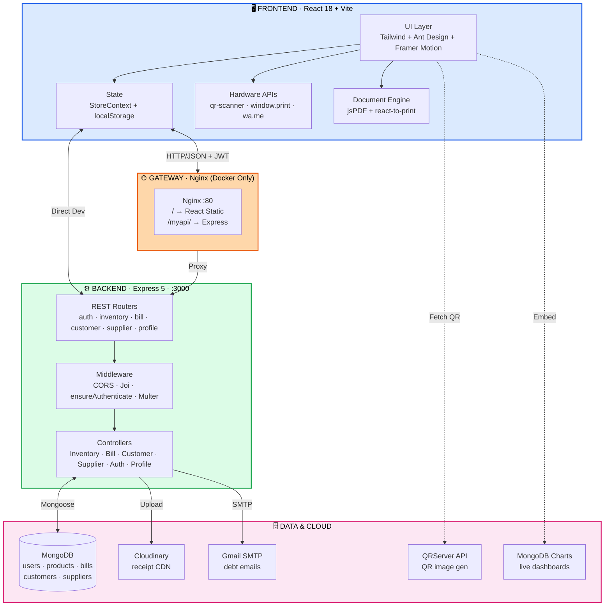
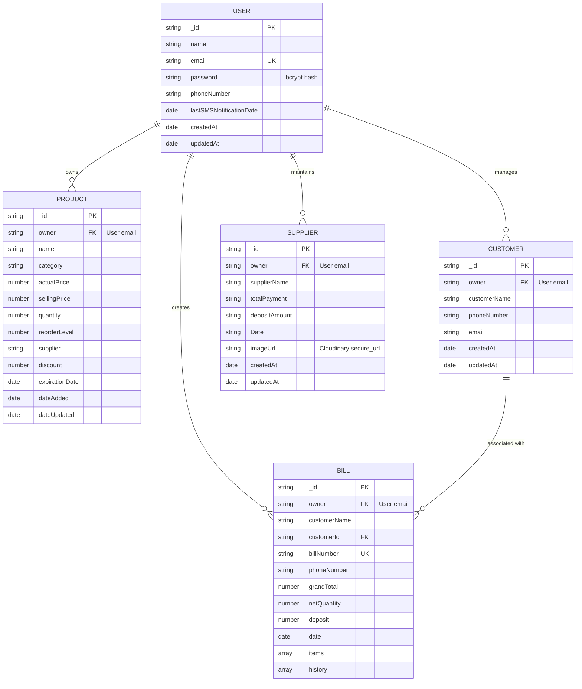

<!-- ═══════════════════════════════════════════════════════════════════════════
     SHOPMANAGER · Terminal Retail OS
     POS · Inventory · Credit Ledger · Analytics
     ═══════════════════════════════════════════════════════════════════════════ -->

<div align="center">

```
╔══════════════════════════════════════════════════════════════════════════════╗
║  ┌──────────────────────────────────────────────────────────────────────┐    ║
║  │  ███████╗██╗  ██╗ ██████╗ ██████╗     ███╗   ███╗ ██████╗ ██████╗    │    ║
║  │  ██╔════╝██║  ██║██╔═══██╗██╔══██╗    ████╗ ████║██╔════╝ ██╔══██╗   │    ║
║  │  ███████╗███████║██║   ██║██████╔╝    ██╔████╔██║██║  ███╗██████╔╝   │    ║
║  │  ╚════██║██╔══██║██║   ██║██╔═══╝     ██║╚██╔╝██║██║   ██║██╔══██╗   │    ║
║  │  ███████║██║  ██║╚██████╔╝██║         ██║ ╚═╝ ██║╚██████╔╝██║  ██║   │    ║
║  │  ╚══════╝╚═╝  ╚═╝ ╚═════╝ ╚═╝         ╚═╝     ╚═╝ ╚═════╝ ╚═╝  ╚═╝   │    ║
║  │                                                                      │    ║
║  │  ▓▓▓▓▓▓░░▓▓▓░▓▓░▓▓▓▓▓░░▓▓▓▓▓░▓▓▓░░▓▓▓▓░░▓▓▓▓▓░░▓▓▓░▓▓▓▓▓░▓▓▓▓▓░░▓▓▓  │    ║
║  │  RETAIL OS · v1.0 · SM-INV-2025 · STORE #0001 · ONLINE              │    ║
║  └──────────────────────────────────────────────────────────────────────┘    ║
╚══════════════════════════════════════════════════════════════════════════════╝
```

# 🛒 SHOPMANAGER

### Smart Inventory Management · Retail POS · Customer Credit Ledger

**`[ INVENTORY ] · [ POS ] · [ KHATA ] · [ ANALYTICS ] · [ SUPPLIER ] · [ QR ]`**

<br>

[](https://react.dev/)
[](https://vitejs.dev/)
[](https://nodejs.org/)
[](https://expressjs.com/)

[](https://www.mongodb.com/)
[](https://tailwindcss.com/)
[](https://www.docker.com/)
[](https://vercel.com/)

<br>

<a href="https://smart-inventory-management-system-frontend.vercel.app/"><b>▶ &nbsp;LAUNCH LIVE STORE</b></a>

</div>

---

```
  ┌─ SESSION START ─────────────────────────────────────────────────────────┐
  │  terminal@shopmanager:~$                                               │
  │                                                                         │
  │  ▸ Storefront ready                                                     │
  │  ▸ Inventory synchronized                                               │
  │  ▸ POS terminal online                                                  │
  │  ▸ Khata ledger loaded                                                  │
  │  ▸ Awaiting merchant sign-in...                                        │
  │                                                                         │
  │  ─────────────────────────────────────────────────────────────────────  │
  │  Customers in queue: 0  ·  Open bills: 0  ·  Stock alerts: 0            │
  └─────────────────────────────────────────────────────────────────────────┘
```

---

## 🧾 Manifest

<table>
<tr>
<td valign="top" width="33%">

### `# INVENTORY`
- [Overview](#-overview)
- [Key Features](#-key-features)
- [Screenshots](#-screenshots--visual-tour)

### `# STACK`
- [Technology Stack](#-technology-stack)
- [Architecture](#-system-architecture)
- [Repo Layout](#-repository-structure)

</td>
<td valign="top" width="33%">

### `# DEPLOY`
- [Prerequisites](#-prerequisites)
- [Installation](#-installation--setup)
- [Environment](#-environment-variables)
- [Running](#-running-the-application)

### `# USE`
- [User Walkthrough](#-user-walkthrough)
- [API Reference](#-api-reference)
- [Data Models](#-database--data-models)

</td>
<td valign="top" width="33%">

### `# OPS`
- [Testing](#-testing--code-quality)
- [Deployment](#-deployment-configuration)
- [Security](#-security--privacy-considerations)

### `# REF`
- [Troubleshooting](#-troubleshooting--faq)
- [Roadmap](#-roadmap)
- [Contributing](#-contributing)

</td>
</tr>
</table>

---

## 🧾 Overview

### `> PROBLEM.LOG`

```
  ┌─────────────────────────────────────────────────────────────────────────┐
  │  ⚠  KIRANA STORE PAIN POINTS                                            │
  ├─────────────────────────────────────────────────────────────────────────┤
  │                                                                         │
  │  [01]  PAPER KHATA FRICTION                                            │
  │        Credit balances written in notebooks → lost, damaged, disputed  │
  │                                                                         │
  │  [02]  CHECKOUT QUEUE BOTTLENECK                                       │
  │        Manual price lookup · paper receipts · peak-hour gridlock       │
  │                                                                         │
  │  [03]  INVENTORY SHRINKAGE & EXPIRATION WASTE                          │
  │        Perishables expire on back shelves · no reorder alerts          │
  │                                                                         │
  │  [04]  UNRECONCILED SUPPLIER INVOICES                                  │
  │        Paper vendor slips scattered · no payable tracking              │
  │                                                                         │
  │  [05]  ENTERPRISE POS COST BARRIER                                     │
  │        Proprietary scanners · desktops · recurring SaaS fees           │
  │                                                                         │
  └─────────────────────────────────────────────────────────────────────────┘
```

### `> SOLUTION.DIFF`

```
  ┌─────────────────────────────┐     ┌─────────────────────────────────┐
  │  BEFORE                     │     │  AFTER                          │
  │  ───────                    │  →  │  ─────                          │
  │                             │     │                                 │
  │  Paper khata notebook       │     │  Digital credit ledger          │
  │  Manual price lookup        │     │  Camera QR scanning             │
  │  Silent stock-outs          │     │  Threshold alerts + expiry tags │
  │  Scattered invoices         │     │  Cloudinary-archived receipts   │
  │  ₹5,000+ POS subscriptions  │     │  ₹0 — runs on any device        │
  │                             │     │                                 │
  └─────────────────────────────┘     └─────────────────────────────────┘
```

**ShopManager** = POS terminal + QR inventory + Khata ledger + supplier tracking + analytics — **all in one mobile-friendly SPA**. Turns any phone/tablet/PC browser into a full retail management station.

### `> TARGET.SEGMENTS`

```
  ┌─────────────────────────┬──────────────────────────────────────────────┐
  │  🏪 MERCHANTS           │  Kirana · hardware · apparel · electronics   │
  ├─────────────────────────┼──────────────────────────────────────────────┤
  │  👥 STORE STAFF         │  Cashiers · managers · floor supervisors     │
  ├─────────────────────────┼──────────────────────────────────────────────┤
  │  🧑‍💻 REVIEWERS          │  Full-stack MERN · JWT · transactional DB    │
  │                         │  camera APIs · cloud media · containerized   │
  └─────────────────────────┴──────────────────────────────────────────────┘
```

---

## ⚙️ Key Features

### `[ 01 ]` POS Terminal · Fast Billing

```
  ┌─ SCAN ────────────────┐    ┌─ CART ─────────────────────────────┐
  │  ▓▓▓▓░░▓▓░▓▓▓▓░▓▓▓░░  │    │  SKU-1042  Dettol 250ml    × 2     │
  │  ▓▓░▓▓▓▓░░▓▓░▓▓▓▓▓░▓  │ →  │  SKU-2210  Maggi 12-pack   × 1     │
  │  ▓▓▓▓▓░▓▓▓░▓▓▓░▓▓▓▓▓  │    │  SKU-3187  Colgate Strong  × 3     │
  │  camera-live · qr-scan│    │  ─────────────────────────────     │
  └───────────────────────┘    │  Subtotal        ₹ 487.00          │
                               │  Discount (5%)   −₹ 24.35          │
                               │  ─────────────────────────────     │
                               │  TOTAL          ₹ 462.65           │
                               └────────────────────────────────────┘
```

| Capability | Stack |
|:---|:---|
| 🎥 **Live QR/barcode scanning** | `qr-scanner` via device camera |
| 🧮 **Dynamic cart math** | Subtotal · % discount · net qty · grand total |
| 📦 **Atomic stock decrement** | Same MongoDB workflow on checkout |
| 💰 **Split payment / credit deposit** | Unpaid → customer borrow ledger |
| 🖨️ **Instant receipts** | `react-to-print` · thermal / A4 |
| 📄 **Vector PDF export** | `jspdf` |
| 📱 **WhatsApp invoice delivery** | `wa.me` Click-to-Chat protocol |

---

### `[ 02 ]` Inventory & Stock Control

```
  ┌─ CATALOG GRID ───────────────────────────────────────────────────────┐
  │                                                                      │
  │   ▓▓▓▓▓▓▓▓  ▓▓▓▓▓▓▓▓  ▓▓▓▓▓▓▓▓  ▓▓▓▓▓▓▓▓                            │
  │   Parle-G   Amul      Surf      Tata                                │
  │   ✅ IN     ⚠ LOW     ✅ IN     🔴 OUT                              │
  │   ₹10       ₹58       ₹120      ₹340                                │
  │                                                                      │
  │   ⏰ EXP:   Fresh  ·  Soon  ·  Expired                              │
  └──────────────────────────────────────────────────────────────────────┘
```

| Feature | Detail |
|:---|:---|
| 📋 **Product catalog** | Name · category · cost · selling · qty · reorder level · supplier · discount · expiry |
| 🔳 **QR generation** | `api.qrserver.com` · printable shelf/packaging labels |
| 🚦 **Health badges** | ✅ In Stock · ⚠️ Low Stock (≤ reorder) · 🔴 Out of Stock |
| ⏳ **Expiry tracking** | 🟢 Fresh · 🟡 Expiring in 30d · 🔴 Expired |
| ⚡ **Inline edits** | Qty · cost · selling · no re-creation needed |

---

### `[ 03 ]` Customer Credit Ledger — Digital Khata

> *The feature that replaces the notebook.*

```
  ┌─ LEDGER · Ramesh Kirana Customer ───────────────────────────────────┐
  │                                                                     │
  │  Lifetime purchases      ₹ 47,850.00                                │
  │  Total paid              ₹ 42,500.00                                │
  │  ────────────────────────────────────                               │
  │  OUTSTANDING BALANCE     ₹  5,350.00   ⚠ 18 days overdue           │
  │                                                                     │
  │  Repayment history:                                                 │
  │    12-Oct  ₹ 2,000  · Cash                                          │
  │    05-Oct  ₹ 1,500  · UPI                                           │
  │    28-Sep  ₹ 3,500  · Cash                                          │
  │                                                                     │
  │  [ 📧 Email Reminder ]  [ 💬 WhatsApp ]                             │
  └─────────────────────────────────────────────────────────────────────┘
```

| Feature | Stack |
|:---|:---|
| 👤 **Customer directory** | Name · phone · email · lifetime value |
| 📊 **Auto-aggregated balance** | Purchases − deposits = net outstanding |
| 📝 **Repayment log** | Timestamp · amount · method (Cash/Card/UPI) |
| 📧 **Batch overdue reminders** | `nodemailer` · HTML emails · configurable day threshold |
| 💬 **One-click WhatsApp nudge** | Pre-filled message via `wa.me` |

---

### `[ 04 ]` Supplier Ledger

```
  ┌─ VENDOR ─────────────────────────────────────────────────────────────┐
  │                                                                      │
  │  Distributor        Invoice    Total      Paid      Owing            │
  │  ──────────────────────────────────────────────────────────────      │
  │  Sharma Wholesale   14-Oct    ₹52,000   ₹35,000   ₹17,000  📎       │
  │  Krishna Traders    12-Oct    ₹28,500   ₹28,500   ₹     0  📎       │
  │  Patel Distributor  09-Oct    ₹86,200   ₹60,000   ₹26,200  📎       │
  │                                                                      │
  │  📎 = Cloudinary-archived invoice scan                              │
  └──────────────────────────────────────────────────────────────────────┘
```

- 📸 **Cloud invoice archival** — JPEG/PNG · 5 MB cap · Multer → Cloudinary
- 💰 **Outstanding payable tracking** per distributor
- 🗓️ **Invoice date audit** for reconciliation

---

### `[ 05 ]` Visual Analytics

> *8 live MongoDB Charts panels embedded via `@mongodb-js/charts-embed-dom` · auto-refresh every 5 minutes.*

```
  ┌─────────────────────────────────────────────────────────────────────┐
  │  ▓▓▓▓▓▓░░░░░░░░░░░░░░  Stock Levels vs Reorder Thresholds          │
  │  ▓▓▓░░░░░░░░░▓▓▓▓▓▓▓▓  Product Sales Volume                        │
  │  ▓▓▓▓▓▓▓▓▓▓▓▓▓░░░░░░  Top-Selling Products                         │
  │  ▓▓░░▓▓░░▓▓░░▓▓░░▓▓░  Total Sales per Day                          │
  │  ▓▓▓▓▓░░░░░▓▓▓▓░░░░░  Average Transaction / Month                 │
  │  ▓▓░░░░░░▓▓▓▓▓▓▓░░░░  Expiration Date Monitoring                  │
  │  ▓▓▓▓░░░░▓▓▓▓▓▓░░░░░  Stock Status Overview                       │
  │  ▓▓▓▓▓▓▓▓▓▓▓▓▓▓▓▓░░░  Total Quantity Sold                         │
  └─────────────────────────────────────────────────────────────────────┘
```

Plus: 🗓️ **Interactive invoice calendar** — day/month filters with daily revenue summary.

---

### `[ 06 ]` Operational Scratchpad

- 📝 **In-browser notepad** — persisted to `localStorage`
- 🎯 For return requests · broken packaging · handover notes · quick reminders

---

## 📸 Screenshots · Visual Tour

<table>
<tr>
<td width="50%" align="center">

**🛒 POS Terminal**


<sub>Live camera scan · dynamic cart · one-click receipt</sub>

</td>
<td width="50%" align="center">

**📦 Product Catalog**


<sub>Stock + expiry badges · inline edits · QR print</sub>

</td>
</tr>
<tr>
<td width="50%" align="center">

**➕ Add Product**


<sub>Full metadata intake · supplier · expiry date</sub>

</td>
<td width="50%" align="center">

**📊 Sales Analytics**


<sub>Live MongoDB Charts · auto-refresh dashboard</sub>

</td>
</tr>
<tr>
<td colspan="2" align="center">

**🧾 Invoice Archive**


<sub>Calendar-filtered invoice history · daily revenue aggregation</sub>

</td>
</tr>
</table>

---

## 🛠️ Technology Stack

<table>
<tr>
<td valign="top" width="50%">

### ⚛️ FRONTEND

| Tech | Version | Role |
|:---|:---|:---|
| React | `18.3.1` | UI · lifecycle · state |
| Vite | `6.2.5` | Bundler · dev server |
| Tailwind CSS | `3.4.13` | Utility-first styling |
| React Router DOM | `6.26.2` | SPA routing · `PrivateRoute` |
| Context API | *native* | Global store (`StoreContext`) |
| Axios | `1.7.7` | HTTP client |
| Ant Design | `5.24.6` | Pre-styled components |
| Framer Motion | `12.6.3` | Micro-animations |
| Lucide + React Icons | `0.487` / `5.5` | Vector icons |
| QR Scanner | `1.4.2` | Camera QR/barcode |
| jsPDF | `3.0.1` | Vector PDF invoices |
| React-To-Print | `3.0.1` | Native print dialog |
| React Datepicker | `8.3.0` | Invoice calendar |
| MongoDB Charts SDK | `3.3.1` | Embedded analytics |
| React Toastify | `10.0.5` | Notifications |

</td>
<td valign="top" width="50%">

### ⚙️ BACKEND

| Tech | Version | Role |
|:---|:---|:---|
| Node.js | `18.x` / `20.x` | JS runtime |
| Express.js | `5.1.0` | REST API · middleware |
| Mongoose | `8.13.2` | ODM · schema validators |
| jsonwebtoken | `9.0.2` | JWT · 24h expiry |
| bcrypt | `5.1.1` | 10-round hashing |
| Joi | `17.13.3` | Request validation |
| Multer | `1.4.5-lts.2` | Multipart uploads |
| Cloudinary SDK | `2.6.0` | Receipt image CDN |
| Nodemailer | `7.0.9` | SMTP email transport |
| CORS | `2.8.5` | Cross-origin |
| dotenv | `16.4.7` | Env loader |

### 🏗️ INFRASTRUCTURE

| Tech | Role |
|:---|:---|
| Docker + Dockerfile | Multi-stage container builds |
| Nginx Alpine | Reverse proxy · static server |
| Docker Compose | Multi-container bridge |
| Vercel | Serverless + SPA hosting |

</td>
</tr>
</table>

---

## 🏛️ System Architecture



### 🔒 Multi-Tenant Data Isolation

Every core document (`Product` · `Bill` · `Customer` · `Supplier`) carries an `owner` field populated from the verified JWT:

```javascript
const documents = await Product.find({ owner: req.user.email });
//                                    ▲
//                                    └── every read/write scoped to merchant
```

**Store A can never see Store B's data** — enforced at the query layer, not the UI.

---

## 📂 Repository Structure

```text
ShopManager-Smart-Inventory-Management-App/
│
├── 🐳 docker-compose.yml              Multi-container: Nginx + Backend
├── 🐳 dockerfile                      Multi-stage React → Nginx runtime
├── 📖 readme.md
│
├── 🌐 Nginx/
│   └── default.conf                   / → React  ·  /myapi/ → Express
│
├── ⚙️ backend/                        ── Express REST API ──
│   ├── server.js                      Bootstrap · middleware · routes
│   ├── vercel.json                    Serverless deploy descriptor
│   ├── dockerfile                     Two-stage Node container
│   ├── config/
│   │   └── cloudinary.js              SDK config + upload helper
│   ├── controllers/
│   │   ├── AuthController.js          signup (bcrypt) · login (JWT)
│   │   ├── BillController.js          POS bill · stock decrement · history
│   │   ├── CustomerController.js      Customer CRUD + batch email reminders
│   │   ├── dbController.js            Mongoose connection
│   │   ├── InventoryController.js     Product CRUD + search
│   │   ├── ProductController.js       Read-only product list
│   │   ├── ProfileController.js       Store/user profile
│   │   └── SupplierController.js      Supplier + Cloudinary upload
│   ├── Middleware/
│   │   ├── auth.js                    ensureAuthenticate · JWT verify
│   │   ├── AuthValidation.js          Joi rules (signup · login)
│   │   └── multer.js                  5 MB cap · image-only
│   ├── models/
│   │   ├── Bill.js                    Line items · deposits · history
│   │   ├── Customer.js                Contact info
│   │   ├── Product.js                 Pricing · stock · supplier · expiry
│   │   ├── supplier.js                Dues · Cloudinary URL
│   │   └── User.js                    Password toJSON strip
│   └── routes/
│       ├── authRoutes.js              /sign-up · /login
│       ├── billRoutes.js              /create · /getbill · /update/:id
│       ├── customerRoutes.js          /add · /all · /send-reminders
│       ├── inventoryRoutes.js         /add · /list · /update · /delete
│       ├── productRoutes.js           /products
│       ├── profileRoutes.js           /profile · /manage-profile
│       └── supplierRoutes.js          /supplier-data · /suppliers
│
└── 🖥️ Frontend/                        ── React 18 + Vite SPA ──
    ├── index.html
    ├── vercel.json                    SPA rewrite rules
    ├── vite.config.js
    ├── tailwind.config.js
    ├── postcss.config.js
    ├── eslint.config.js
    ├── public/
    │   ├── addproduct.png
    │   ├── billgen.png
    │   ├── logo.gif
    │   ├── productlist.png
    │   ├── sales.png
    │   └── showbill.png
    └── src/
        ├── App.jsx                    Routes + PrivateRoute gate
        ├── main.jsx                   React DOM root
        ├── utils.js                   Toastify helpers
        ├── Context/
        │   └── StoreContext.jsx       Auth · bills · customers global store
        └── component/
            ├── billgenerator.jsx      POS screen + camera scanner
            ├── dashboard.jsx          Merchant dashboard
            ├── inventorymanager.jsx   CRUD + QR generation
            ├── ProductList.jsx        Catalog + stock/expiry filters
            ├── CustomerAccount.jsx    Credit ledger overview
            ├── CustomerHistory.jsx    Per-customer ledger + repay modal
            ├── SupplierData.jsx       Vendor ledger + receipt upload
            ├── StockAnalysis.jsx      Embedded MongoDB Charts
            ├── ShowBill.jsx           Invoice archive + calendar
            ├── Notes.jsx              localStorage scratchpad
            ├── login.jsx / signup.jsx
            ├── navbar.jsx / footer.jsx
            └── profile.jsx
```

---

## 📋 Prerequisites

```
  ┌─ REQUIRED ──────────────────────────────────────────────────────────┐
  │                                                                     │
  │  [✓] Node.js     v18.x or v20.x   (LTS · tested to v24)             │
  │  [✓] npm         v9.x+                                              │
  │  [✓] MongoDB     local :27017 or Atlas URI                          │
  │  [✓] Browser     Chrome · Firefox · Edge · Safari                   │
  │                  📷 camera permission required for QR scan          │
  │                                                                     │
  └─────────────────────────────────────────────────────────────────────┘

  ┌─ OPTIONAL ──────────────────────────────────────────────────────────┐
  │                                                                     │
  │  [○] Gmail account + App Password   → debt reminder emails          │
  │  [○] Cloudinary account             → supplier receipt CDN          │
  │  [○] Docker + Compose               → containerized deployment      │
  │                                                                     │
  └─────────────────────────────────────────────────────────────────────┘
```

---

## ⚙️ Installation & Setup

### `» 01` Clone

```bash
git clone https://github.com/yash-shende99/ShopManager-Smart-Inventory-Management-App.git
cd ShopManager-Smart-Inventory-Management-App
```

### `» 02` Configure Backend

```bash
cd backend
npm install
```

Create `backend/.env`:

```env
PORT=3000
MONGO_URL=mongodb+srv://<user>:<pass>@cluster0.mongodb.net/shopmanager?retryWrites=true&w=majority
JWT_SECRET=your_super_secret_jwt_key_min_32_characters

# Optional — email reminders
EMAIL_USER=your_store_email@gmail.com
EMAIL_PASS=your_16_character_gmail_app_password

# Optional — Cloudinary receipt uploads
CLOUDINARY_NAME=your_cloudinary_cloud_name
CLOUDINARY_API_KEY=your_cloudinary_api_key
CLOUDINARY_API_SECRET=your_cloudinary_api_secret
```

> Windows: `New-Item -ItemType File -Name .env` &nbsp;·&nbsp; Linux/macOS: `touch .env`

### `» 03` Configure Frontend

```bash
cd ../Frontend
npm install
```

> 💡 **Dev default:** `StoreContext.jsx` points to `http://localhost:3000`. Ensure backend runs on port `3000`.

---

## 🔐 Environment Variables

**`backend/.env`**

| Variable | Req | Default | Purpose |
|:---|:--:|:---|:---|
| `PORT` | ○ | `3000` | Express listen port |
| `MONGO_URL` | ✅ | — | MongoDB connection URI |
| `JWT_SECRET` | ✅ | — | JWT signing key |
| `EMAIL_USER` | ○ | — | Gmail address for Nodemailer |
| `EMAIL_PASS` | ○ | — | Gmail 16-char App Password |
| `CLOUDINARY_NAME` | ○ | — | Cloudinary cloud name |
| `CLOUDINARY_API_KEY` | ○ | — | Cloudinary API key |
| `CLOUDINARY_API_SECRET` | ○ | — | Cloudinary API secret |

> [!CAUTION]
> 🚨 **Never commit `backend/.env`.** Add it to `.gitignore`. Rotate any leaked keys immediately.

---

## 🏃 Running the Application

### `▸ Local Development` — 2 terminals

<table>
<tr>
<td width="50%">

**Terminal 1 · Backend**

```bash
cd backend
npm run server     # nodemon
# or
npm start          # plain node
```

Expected:
```
server listening on port 3000
mongodb connected successfully
```

</td>
<td width="50%">

**Terminal 2 · Frontend**

```bash
cd Frontend
npm run dev
```

Expected:
```
VITE v6.2.5 ready
→ http://localhost:5173/
```

</td>
</tr>
</table>

**🌐 Open:** http://localhost:5173

### `▸ Docker Compose`

```bash
docker compose up --build
```

| Service | URL |
|:---|:---|
| Frontend + Proxy | http://localhost:80 |
| Nginx routes `/` | → React static bundle |
| Nginx routes `/myapi/` | → `backend:3000` (internal) |

Stop: `docker compose down`

---

## 📖 User Walkthrough

```
  ┌───┐   ┌───┐   ┌───┐   ┌───┐   ┌───┐   ┌───┐
  │ 1 │ → │ 2 │ → │ 3 │ → │ 4 │ → │ 5 │ → │ 6 │
  └───┘   └───┘   └───┘   └───┘   └───┘   └───┘
   Sign   Populate Print  POS    Manage  Review
   up     Catalog  QR     Scan   Khata   Analytics
```

**`[1]` Merchant Onboarding**
Register at `/signup` → login at `/login` → 24h JWT stored in `localStorage`.

**`[2]` Catalog Creation**
Open **Inventory Manager** (`/inventorymanager`) → **Add Product** → name · category · cost · selling · qty · reorder · supplier · expiry.

**`[3]` Print QR Labels**
Click the **QR icon** → generated via `api.qrserver.com` → **Print QR Code** for shelf/packaging.

**`[4]` POS Billing**
Open **Bill Generator** (`/billgenerator`) → **Start Scanner** → hold product QR to camera → auto-added. Or search dropdown. Enter customer + deposit (or blank for full payment) → **Create Bill**.
→ **Save as PDF** or **Share via WhatsApp** for instant digital receipt.

**`[5]` Khata Management**
Open **Customer Accounts** (`/customeraccount`) → view outstanding balances → **View History** for itemized unpaid bills → **Update Deposit** on repayment → **Send Reminders** with day threshold (default 5d) fires batch HTML emails.

**`[6]` Supplier Ledger**
Open **Supplier Data** (`/supplierData`) → log deliveries · payables · deposits · attach photo scan → uploaded to Cloudinary.

**`[7]` Analytics**
Open **Stock Analysis** (`/stockanalysis`) → 8 live MongoDB Charts panels.

---

## 📡 API Reference

> **Auth header:** `Authorization: <jwt_token>`

<details>
<summary><b>🔑 Auth</b> — <code>/api</code></summary>

<br>

| Method | Endpoint | Auth | Payload | Response |
|:---:|:---|:--:|:---|:---|
| `POST` | `/api/sign-up` | ❌ | `{ name, email, password, phoneNumber }` | `200 OK` |
| `POST` | `/api/login` | ❌ | `{ email, password }` | `{ jwttoken, email, name }` |

</details>

<details>
<summary><b>👤 Profile</b> — <code>/api</code></summary>

<br>

| Method | Endpoint | Auth | Payload | Response |
|:---:|:---|:--:|:---|:---|
| `GET` | `/api/profile` | ✅ | — | `{ user: { name, email, phoneNumber } }` |
| `POST` | `/api/manage-profile` | ✅ | `{ phoneNumber, businessName }` | `200 OK` |

</details>

<details>
<summary><b>📦 Inventory</b> — <code>/api/inventory</code> · <code>/api</code></summary>

<br>

| Method | Endpoint | Auth | Payload / Query |
|:---:|:---|:--:|:---|
| `POST` | `/api/inventory/add` | ✅ | Product JSON |
| `GET` | `/api/inventory/list?search=` | ✅ | Optional regex term |
| `PUT` | `/api/inventory/update-product/:id` | ✅ | `{ quantity, actualPrice, sellingPrice }` |
| `DELETE` | `/api/inventory/delete/:id` | ✅ | — |
| `GET` | `/api/products` | ✅ | — |

</details>

<details>
<summary><b>🧾 Billing & POS</b> — <code>/api/bill</code></summary>

<br>

| Method | Endpoint | Auth | Payload |
|:---:|:---|:--:|:---|
| `POST` | `/api/bill/create` | ✅ | `{ customerName, phoneNumber, deposit, customerId, items }` |
| `GET` | `/api/bill/getbill` | ✅ | — |
| `PUT` | `/api/bill/update/:billId` | ✅ | `{ history: depositAmount }` |

</details>

<details>
<summary><b>👥 Customer & Ledger</b> — <code>/api/customer</code></summary>

<br>

| Method | Endpoint | Auth | Payload |
|:---:|:---|:--:|:---|
| `POST` | `/api/customer/add` | ✅ | `{ customerName, phoneNumber, email }` |
| `GET` | `/api/customer/all` | ✅ | — |
| `POST` | `/api/customer/send-reminders` | ✅ | `{ days: number }` |

</details>

<details>
<summary><b>🚚 Supplier</b> — <code>/api/supplier</code></summary>

<br>

| Method | Endpoint | Auth | Payload |
|:---:|:---|:--:|:---|
| `POST` | `/api/supplier/supplier-data` | ✅ | Multipart · `supplierName · totalPayment · depositAmount · date · image` |
| `GET` | `/api/supplier/suppliers` | ✅ | — |

</details>

---

## 🗄️ Database & Data Models



---

## 🧪 Testing & Code Quality

### `» Frontend Lint`

```bash
cd Frontend
npm run lint
```

ESLint 9 + `eslint-plugin-react` · `react-hooks` · `react-refresh`.

### `» Build Verification`

```bash
cd Frontend
npm run build
```

Runs `vite build` → outputs to `Frontend/dist/`.

### `» Test Status`

| Layer | Status |
|:---|:---|
| Frontend lint | ✅ Configured |
| Frontend build | ✅ Working |
| Backend tests | ⏳ Not yet implemented |
| Manual E2E | ✅ All API flows verified |

**Recommended stack for contributors:** Jest · Supertest (backend) · Vitest + RTL (frontend).

---

## 🚀 Deployment Configuration

<table>
<tr>
<td valign="top" width="50%">

### `▸ Vercel`

- **Frontend** (`Frontend/vercel.json`) — SPA rewrite: `"source": "/(.*)", "destination": "/"` → React Router handles routes on refresh
- **Backend** (`backend/vercel.json`) — `@vercel/node` serverless function routes to Express

</td>
<td valign="top" width="50%">

### `▸ Docker + Nginx`

- **Root `dockerfile`** — Multi-stage: `node:20-alpine` builds → `nginx:alpine` serves
- **`backend/dockerfile`** — Two-stage: `node:18` build → `node:18-slim` runtime
- **`docker-compose.yml`** — `app-network` bridge · Nginx proxy to backend

</td>
</tr>
</table>

---

## 🔒 Security & Privacy Considerations

| 🛡️ Layer | Implementation |
|:---|:---|
| **Password storage** | `bcrypt` · 10 salt rounds · never plaintext |
| **Password exposure** | `User.toJSON` strips `password` before serialization |
| **Input validation** | Joi schemas (`AuthValidation.js`) — email · password length · 10-digit phone |
| **JWT auth** | `ensureAuthenticate` middleware · missing header → `403` |
| **Multi-tenant isolation** | `{ owner: req.user.email }` on every read/write |
| **Upload safeguards** | Multer · `image/jpeg` + `image/png` only · 5 MB cap · immediate temp cleanup |

---

## ❓ Troubleshooting & FAQ

<details>
<summary><b>① <code>MongooseServerSelectionError</code> / <code>ECONNREFUSED</code></b></summary>

<br>

**Symptom:** Crash on startup · `Error Occurred in mongodb Connection`

**Cause:** Bad `MONGO_URL` · IP not whitelisted in Atlas

**Fix:**
1. Atlas → **Network Access** → **Add IP** → `0.0.0.0/0` (dev only)
2. URL-encode special chars in DB password (`@` → `%40`, etc.)

</details>

<details>
<summary><b>② Nodemailer fails with <code>535-5.7.8 Invalid login</code></b></summary>

<br>

**Cause:** Using regular Google account password instead of App Password.

**Fix:** Google Account → **Security** → **2-Step Verification** → **App passwords** → generate 16-char password → set as `EMAIL_PASS`.

</details>

<details>
<summary><b>③ QR camera shows black screen / "Camera Access Denied"</b></summary>

<br>

**Cause:** Browser blocks camera on insecure origins.

**Fix:** Use `http://localhost:5173` or HTTPS. Check browser site permissions.

</details>

<details>
<summary><b>④ Supplier receipt upload fails (<code>500 Failed to upload image</code>)</b></summary>

<br>

**Cause:** Missing/wrong Cloudinary credentials.

**Fix:** Verify `CLOUDINARY_NAME` · `CLOUDINARY_API_KEY` · `CLOUDINARY_API_SECRET` in `backend/.env` — no quotes.

</details>

<details>
<summary><b>⑤ Docker backend healthcheck unhealthy</b></summary>

<br>

**Cause:** `docker-compose.yml` curls `/health` but routes mount under `/api`.

**Fix:** Add `app.get('/health', (req, res) => res.status(200).send('OK'))` in `server.js` — or point healthcheck to `/api/products` with auth.

</details>

---

## 🚧 Known Limitations & Current Status

```
  ┌─ TRANSPARENCY.LOG ──────────────────────────────────────────────────┐
  │                                                                     │
  │  [01] Twilio dependency declared, SMS sending NOT active            │
  │       → Reminders delivered via Nodemailer + wa.me only             │
  │                                                                     │
  │  [02] Dashboard overview cards show demo stats                      │
  │       → Real analytics live in /stockanalysis (MongoDB Charts)      │
  │                                                                     │
  │  [03] StoreContext.jsx hardcodes http://localhost:3000              │
  │       → Should migrate to import.meta.env.VITE_API_URL              │
  │                                                                     │
  │  [04] Nginx proxies /myapi/ but dev clients hit /api directly       │
  │       → Path mismatch noted for production alignment                │
  │                                                                     │
  └─────────────────────────────────────────────────────────────────────┘
```

---

## 🗺️ Roadmap

```
  ✅ SHIPPED                                              ⏳ NEXT
  ─────────                                               ───────
  ✅ Multi-tenant JWT + bcrypt auth                       ⏳ VITE_API_URL env migration
  ✅ Product CRUD · reorder · expiry                      ⏳ /health endpoint for Docker
  ✅ QR generation + printing                             ⏳ Jest · Supertest · Vitest suites
  ✅ Live camera QR POS billing                           ⏳ Twilio SMS gateway
  ✅ jsPDF · react-to-print invoices                      ⏳ CSV export (inventory · sales)
  ✅ WhatsApp + email reminders
  ✅ Customer khata ledger · installment log
  ✅ Supplier Cloudinary receipts
  ✅ MongoDB Charts analytics
```

---

## 🤝 Contributing

```
  ┌─────────────────────────────────────────────────────────────────────┐
  │  FORK  →  BRANCH  →  CODE  →  LINT  →  BUILD  →  PR                 │
  └─────────────────────────────────────────────────────────────────────┘
```

```bash
# 1. Fork on GitHub

# 2. Clone your fork
git clone https://github.com/<your-username>/ShopManager-Smart-Inventory-Management-App.git
cd ShopManager-Smart-Inventory-Management-App

# 3. Feature branch
git checkout -b feature/your-feature-name

# 4. Implement + verify
cd Frontend && npm run lint && npm run build

# 5. Commit (conventional)
git commit -m "feat: describe your change cleanly"

# 6. Push + PR
git push origin feature/your-feature-name
```

---

## 📄 License

Backend declares **ISC License** (`backend/package.json`). Commercial licensing per repository owner.

---

## 👤 Author & Links

<table>
<tr>
<td width="50%" valign="top">

**Repository**
[ShopManager — Smart Inventory Management App](https://github.com/yash-shende99/ShopManager-Smart-Inventory-Management-App)

**Live Demo**
[smart-inventory-management-system-frontend.vercel.app](https://smart-inventory-management-system-frontend.vercel.app/)

**Author**
[@yash-shende99](https://github.com/yash-shende99)

</td>
<td width="50%" valign="top">

**Stack at a glance**

`React 18` · `Vite 6` · `Tailwind 3` · `Ant Design` · `Framer Motion`
`Node 18/20` · `Express 5` · `Mongoose 8` · `JWT` · `bcrypt` · `Joi`
`MongoDB` · `Cloudinary` · `Nodemailer` · `QRScanner` · `jsPDF`
`Docker` · `Nginx` · `Vercel`

</td>
</tr>
</table>

---

<div align="center">

```
  ╔══════════════════════════════════════════════════════════════════════╗
  ║                                                                      ║
  ║                    ▓▓▓▓▓▓░░▓▓▓░▓▓░▓▓▓▓▓░░▓▓▓▓▓░▓▓▓░▓▓▓▓░░▓▓▓         ║
  ║                    ▓▓▓░░░▓▓▓▓░░░▓▓░░░▓▓▓░░░▓▓▓░▓▓░░░▓▓▓░░▓▓         ║
  ║                                                                      ║
  ║              THANK YOU FOR VISITING · SESSION COMPLETE               ║
  ║                                                                      ║
  ║                    TERMINAL@SHOPMANAGER:~$ _                         ║
  ║                                                                      ║
  ╚══════════════════════════════════════════════════════════════════════╝
```

<sub>

**SHOPMANAGER · RETAIL OS** — POS · Inventory · Khata · Analytics

*Built for the shopkeepers who still write in notebooks.*

</sub>

</div>

<!-- ═══════════════════════════════════════════════════════════════════════════
     END OF SESSION
     ═══════════════════════════════════════════════════════════════════════════ -->