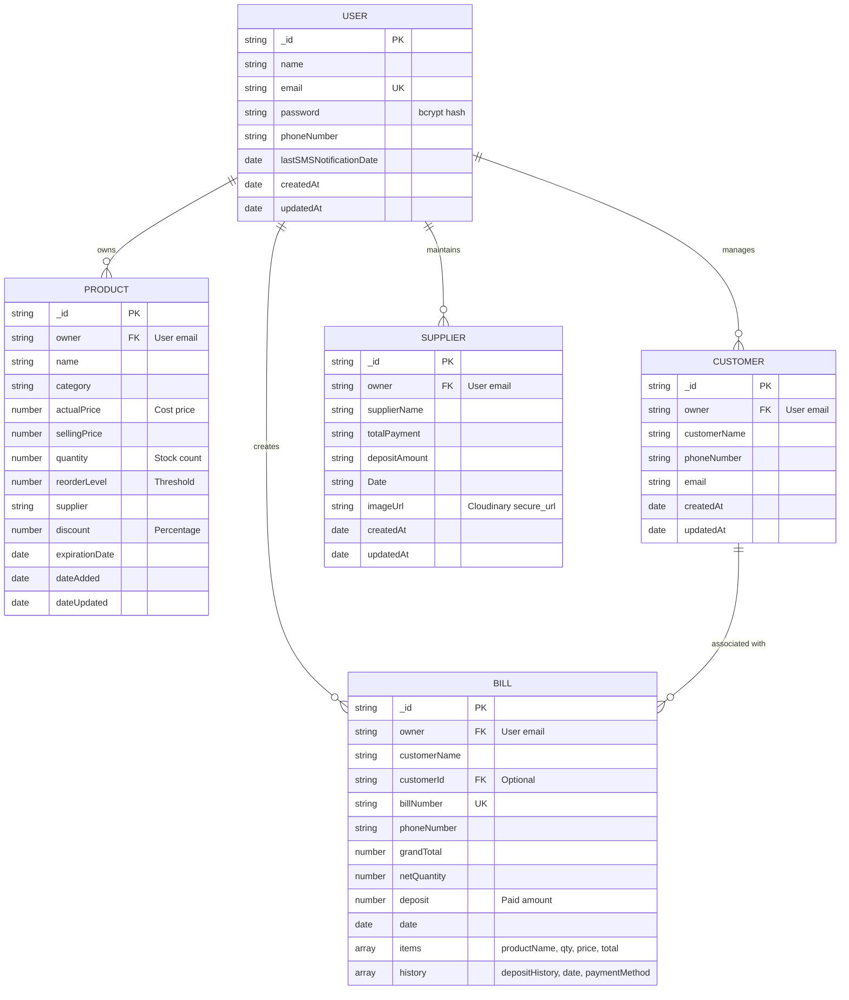

# 🛒 ShopManager — Smart Inventory Management & Retail POS System

[](https://react.dev/)
[](https://vitejs.dev/)
[](https://nodejs.org/)
[](https://expressjs.com/)
[](https://www.mongodb.com/)
[](https://tailwindcss.com/)
[](backend/package.json)

> A modern, web-based Point of Sale (POS), QR-assisted inventory management, and customer credit ledger system engineered specifically for small and medium retail merchants.

---

## 📑 Table of Contents

- [Overview](#overview)
  - [The Problem](#the-problem)
  - [The Solution](#the-solution)
  - [Target Audience](#target-audience)
- [Key Features](#key-features)
  - [1. Point of Sale (POS) & Fast Billing](#1-point-of-sale-pos--fast-billing)
  - [2. Inventory & Stock Management](#2-inventory--stock-management)
  - [3. Customer Credit Ledger ("Borrow Account") & Debt Recovery](#3-customer-credit-ledger-borrow-account--debt-recovery)
  - [4. Supplier Invoice & Payment Tracking](#4-supplier-invoice--payment-tracking)
  - [5. Visual Analytics & Reporting](#5-visual-analytics--reporting)
  - [6. Local Operational Notepad](#6-local-operational-notepad)
- [Screenshots & Visual Tour](#screenshots--visual-tour)
- [Technology Stack](#technology-stack)
- [System Architecture](#system-architecture)
- [Repository Structure](#repository-structure)
- [Prerequisites](#prerequisites)
- [Installation & Setup](#installation--setup)
  - [1. Clone the Repository](#1-clone-the-repository)
  - [2. Configure the Backend](#2-configure-the-backend)
  - [3. Configure the Frontend](#3-configure-the-frontend)
- [Environment Variables](#environment-variables)
- [Running the Application](#running-the-application)
  - [Local Development](#local-development)
  - [Running with Docker Compose](#running-with-docker-compose)
- [User Walkthrough](#user-walkthrough)
- [API Reference](#api-reference)
- [Database & Data Models](#database--data-models)
- [Testing & Code Quality](#testing--code-quality)
- [Deployment Configuration](#deployment-configuration)
- [Security & Privacy Considerations](#security--privacy-considerations)
- [Troubleshooting & FAQ](#troubleshooting--faq)
- [Known Limitations & Current Status](#known-limitations--current-status)
- [Roadmap](#roadmap)
- [Contributing](#contributing)
- [License](#license)
- [Author & Links](#author--links)

---

## 🌟 Overview

### The Problem

Small retail merchants and convenience shopkeepers (such as local kirana stores, hardware shops, and general trading outlets) struggle with disconnected, manual store operations:

1. **Paper Ledgers ("Khata") Friction**: Customer credit balances and partial repayments are written in paper notebooks that get lost, damaged, or contested.
2. **Slow Checkout Queues**: Manual price memorization and paper receipts slow down peak-hour billing.
3. **Inventory Shrinkage & Expiration Waste**: Perishable stock expires unnoticed on back shelves, and stock shortages happen unexpectedly without threshold alerts.
4. **Disorganized Supplier Invoices**: Paper vendor invoices and cash payment slips are hard to reconcile against delivered stock.
5. **High Software Costs**: Enterprise POS systems require expensive proprietary barcode scanners, heavy desktop computers, and recurring subscription fees.

### The Solution

**ShopManager** bridges the gap between pen-and-paper operations and enterprise retail software. It delivers a fast, responsive Single Page Application (SPA) accessible on any mobile device, tablet, or PC browser. ShopManager turns standard device cameras into real-time barcode/QR scanners, automates stock decrements upon sale, maintains an audit-logged customer credit ledger with automated email payment reminders, enables frictionless digital receipt sharing via WhatsApp, and provides visual stock analytics without proprietary hardware requirements.

### Target Audience

- **Independent Retailers & Merchants**: Grocery stores, local marts, apparel stores, and electronics accessory shops.
- **Store Managers & Cashiers**: Requiring a clean, error-resistant POS interface with instant receipt printing.
- **Hiring Managers & Technical Reviewers**: Evaluating a real-world, full-stack MERN application demonstrating authentication, hardware API integration (camera/scanner), transactional MongoDB workflows, third-party cloud integrations (Cloudinary, Nodemailer), and containerization.

---

## 🚀 Key Features

### 1. Point of Sale (POS) & Fast Billing
- **Real-Time Barcode & QR Code Scanning**: Utilizes the device camera via `qr-scanner` to read product QR labels directly into the active cart without manual typing.
- **Dynamic Cart Calculations**: Automatically computes item totals, percentage-based discounts, net quantities, and grand totals.
- **Immediate Stock Sync**: Every completed bill automatically verifies stock availability and decrements inventory in MongoDB within the same checkout workflow.
- **Split Payment & Credit Deposits**: Allows customers to pay in full or pay a partial deposit, automatically forwarding unpaid balances to the customer's borrow ledger.
- **Instant Receipts**: Generates print-ready thermal/A4 invoices via `react-to-print` and exportable digital PDF receipts via `jspdf`.
- **WhatsApp Invoice Delivery**: Formats the complete itemized bill summary into a pre-populated message and opens WhatsApp Web / WhatsApp Mobile directly via the WhatsApp Click-to-Chat protocol (`wa.me`).

### 2. Inventory & Stock Management
- **Product Catalog Management**: Track product name, category, cost price (actual price), selling price, quantity on hand, minimum reorder thresholds, supplier names, discount rates, and expiration dates.
- **Dynamic QR Code Generation**: Generates scannable QR codes for each inventory item using the QRServer API (`https://api.qrserver.com/`), printable directly for shelf and product labeling.
- **Inventory Health Badges**: Color-coded stock indicators classifying items as **In Stock**, **Low Stock** (quantity $\le$ reorder level), or **Out of Stock**.
- **Perishable Expiration Tracking**: Flags products as **Fresh**, **Expiring Soon** (within 30 days), or **Expired**.
- **Inline Stock Adjustments**: Fast modals for updating stock quantities, cost prices, and selling prices without recreating records.

### 3. Customer Credit Ledger ("Borrow Account") & Debt Recovery
- **Customer Directory**: Centralized ledger mapping customer profiles (name, phone number, email) to purchase records.
- **Credit & Debt Calculation**: Aggregates all historical bills for each customer to show lifetime purchases, total deposits paid, and current net outstanding balance.
- **Repayment History Log**: Allows cashiers to record installments against unpaid bills, logging each payment with timestamps and payment methods (`Cash`, `Credit Card`, `Debit Card`, `Mobile Payment`).
- **Automated Email Payment Reminders**: Built-in batch notification engine powered by `nodemailer` that filters customers with overdue balances past a configurable day threshold (default: 5+ days) and dispatches formatted HTML balance summaries.
- **One-Click WhatsApp Reminders**: Direct link to trigger a personalized payment reminder to the customer's registered phone number.

### 4. Supplier Invoice & Payment Tracking
- **Vendor Ledger**: Maintains supplier profiles, invoice dates, agreed payments, and deposits made.
- **Cloud Receipt Archival**: Enables merchants to upload physical supplier bills (JPEG/PNG up to 5MB) via `multer`, securely stored and served via Cloudinary.
- **Outstanding Payable Balance**: Calculates real-time remaining liabilities owed to each distributor.

### 5. Visual Analytics & Reporting
- **MongoDB Charts Integration**: Embeds 8 live visual analytics panels using `@mongodb-js/charts-embed-dom` with automatic 5-minute data refreshes:
  - Current Stock Levels vs. Reorder Thresholds
  - Stock Status Overview
  - Expiration Date Monitoring
  - Product Sales Volume
  - Total Sales per Day
  - Top-Selling Products
  - Average Transaction per Month
  - Total Quantity Sold
- **Interactive Invoices Calendar**: Filter and audit transaction history by specific day or month with aggregate daily revenue summaries.

### 6. Local Operational Notepad
- **In-Browser Scratchpad**: Quick note-taking feature saved to `localStorage` for staff to jot down return requests, broken packaging, customer requests, or handover notes.

---

## 📸 Screenshots & Visual Tour

The repository includes visual assets demonstrating core workflows:

| Point of Sale & Billing | Product Inventory & Expiry Badges |
| :---: | :---: |
|  |  |
| *Barcode camera scanner, cart itemization, PDF download, and WhatsApp share* | *Searchable catalog with real-time stock levels and expiration indicators* |

| Sales & Analytics Dashboard | Invoice Browser & Calendar Audit |
| :---: | :---: |
|  |  |
| *Embedded MongoDB Charts showing stock turnover and sales metrics* | *Date-picker driven transaction history with daily revenue aggregation* |

| Adding Products to Inventory | Animated Brand Identity |
| :---: | :---: |
|  |  |
| *Product parameters, supplier linking, reorder levels, and expiration dates* | *ShopManager brand visual asset* |

---

## 🛠️ Technology Stack

### Frontend
| Technology | Version | Purpose in ShopManager |
| :--- | :--- | :--- |
| **React** | `18.3.1` | UI rendering, component lifecycle, and state reactivity |
| **Vite** | `6.2.5` | Fast module bundler, dev server, and production build tooling |
| **Tailwind CSS** | `3.4.13` | Utility-first responsive styling and layout system |
| **React Router DOM** | `6.26.2` | Client-side routing, protected routes (`PrivateRoute`), and redirects |
| **Context API** | Native | Application-wide shared state for tokens, bills, and customers (`StoreContext`) |
| **Axios** | `1.7.7` | HTTP client for interacting with the Express REST API |
| **Ant Design (`antd`)** | `5.24.6` | Pre-styled UI components and design icons |
| **Framer Motion** | `12.6.3` | Fluid page transitions and micro-animations |
| **Lucide React** / **React Icons** | `0.487.0` / `5.5.0` | Vector icon sets for navigation, actions, and status cards |
| **QR Scanner** | `1.4.2` | High-performance HTML5 video camera barcode/QR code reader |
| **jsPDF** | `3.0.1` | Client-side vector PDF generation for customer invoices |
| **React-To-Print** | `3.0.1` | Native browser print dialog triggering for thermal/desktop printers |
| **React Datepicker** | `8.3.0` | Calendar date picker used in invoice history filtering |
| **MongoDB Charts SDK** | `3.3.1` | Embedded dashboard analytics rendered via `@mongodb-js/charts-embed-dom` |
| **React Toastify** | `10.0.5` | Non-intrusive alert and notification banners |

### Backend
| Technology | Version | Purpose in ShopManager |
| :--- | :--- | :--- |
| **Node.js** | `18.x` / `20.x` | Server-side JavaScript runtime environment |
| **Express.js** | `5.1.0` | REST API routing, request lifecycle handling, and middleware composition |
| **Mongoose** | `8.13.2` | Object Data Modeling (ODM) for MongoDB schemas and validations |
| **JSON Web Token (`jsonwebtoken`)** | `9.0.2` | Stateless bearer token generation and authentication verification (24h expiry) |
| **bcrypt** | `5.1.1` | Secure password hashing (10 salt rounds) |
| **Joi** | `17.13.3` | Schema validation middleware for auth payloads (`signupValidation`, `loginValidation`) |
| **Multer** | `1.4.5-lts.2` | Multipart form-data handling for image uploads to OS temporary storage |
| **Cloudinary SDK** | `2.6.0` | Cloud media pipeline for uploading and hosting supplier receipt images |
| **Nodemailer** | `7.0.9` | SMTP email transport client sending HTML debt reminder emails via Gmail |
| **CORS** | `2.8.5` | Cross-Origin Resource Sharing middleware enabling frontend API requests |
| **dotenv** | `16.4.7` | Zero-dependency environment variable loader from `.env` |

### Infrastructure & Containerization
| Technology | Purpose |
| :--- | :--- |
| **Docker & Dockerfile** | Multi-stage Docker builds for the React frontend and Node.js backend |
| **Nginx (Alpine)** | Reverse proxy and production static asset web server routing `/` to React and `/myapi/` to Express |
| **Docker Compose** | Multi-container orchestration linking the webserver and backend on a private bridge network |
| **Vercel** | Production hosting configurations (`vercel.json`) for serverless API and SPA routing |

---

## 🏛️ System Architecture

```mermaid
flowchart TD
    subgraph Client["Frontend Client (React 18 + Vite)"]
        UI["UI Layer\nTailwind CSS + Ant Design + Framer Motion"]
        State["State Management\nStoreContext + localStorage"]
        Hardware["Hardware / Browser APIs\nWebcam (qr-scanner) | Window Print | wa.me"]
        ExportEngine["Document Engine\njsPDF + react-to-print"]
    end

    subgraph Gateway["Reverse Proxy & Gateway (Optional Docker Setup)"]
        Nginx["Nginx Web Server (:80)\nRoutes / -> React Static\nRoutes /myapi/ -> Backend"]
    end

    subgraph Server["Backend API (Express 5 + Node.js :3000)"]
        Router["Express REST Routers\n/api/auth | /api/inventory | /api/bill\n/api/customer | /api/supplier | /api/profile"]
        Middleware["Middleware Pipeline\nCORS | Joi Validator | ensureAuthenticate (JWT) | Multer"]
        Controllers["Controllers\nInventoryController | BillController | CustomerController\nSupplierController | AuthController | ProfileController"]
    end

    subgraph Data["Data & Cloud Services"]
        MongoDB[("MongoDB Database\nCollections: users, products,\nbills, customers, suppliers")]
        Cloudinary["Cloudinary CDN\nSupplier Invoice Images"]
        Gmail["Google SMTP (Nodemailer)\nAutomated Debt Recovery Emails"]
        QRServer["QRServer External API\nDynamic QR Code Image Generator"]
        MongoCharts["MongoDB Atlas Charts\nEmbedded Analytics SDK"]
    end

    UI --> Hardware
    UI --> ExportEngine
    UI --> State
    State <-->|HTTP / JSON + JWT Token| Gateway
    Gateway -->|Proxy Pass| Router
    State <-->|Direct Dev API Calls| Router

    Router --> Middleware
    Middleware --> Controllers
    Controllers <-->|Mongoose ODM| MongoDB
    Controllers -->|Upload File Stream| Cloudinary
    Controllers -->|SMTP Protocol| Gmail
    UI -.->|Embed Charts| MongoCharts
    UI -.->|Fetch QR Code Image| QRServer
```



### Data Isolation Architecture
ShopManager implements **multi-tenant data scoping** at the database layer. Every core document (`Product`, `Bill`, `Customer`, `Supplier`) contains an `owner` attribute populated with the authenticated merchant's email extracted from the verified JWT token (`req.user.email`). Database operations are scoped to `{ owner: req.user.email }`, ensuring merchants cannot view or manipulate other stores' records.

---

## 📂 Repository Structure

```text
ShopManager-Smart-Inventory-Management-App/
├── .git/                               # Git version control metadata
├── docker-compose.yml                  # Multi-container orchestration (Nginx + Backend)
├── dockerfile                          # Multi-stage frontend build & Nginx server container
├── readme.md                           # Project documentation
│
├── Nginx/
│   └── default.conf                    # Nginx reverse proxy configuration (/ & /myapi/)
│
├── backend/                            # Express.js REST API
│   ├── .gitignore                      # Backend ignore rules
│   ├── dockerfile                      # Two-stage Node.js container build
│   ├── package.json                    # Backend dependencies and run scripts
│   ├── package-lock.json               # Backend dependency lockfile
│   ├── server.js                       # Express app bootstrap, middleware, and route mounting
│   ├── vercel.json                     # Serverless deployment descriptor for Vercel
│   ├── config/
│   │   └── cloudinary.js               # Cloudinary v2 SDK configuration and upload helper
│   ├── controllers/
│   │   ├── AuthController.js           # User registration (bcrypt) and login (JWT)
│   │   ├── BillController.js           # POS bill creation, stock decrement, and payment history
│   │   ├── CustomerController.js       # Customer records and batch overdue email reminders
│   │   ├── dbController.js             # Mongoose connection initialization
│   │   ├── InventoryController.js      # CRUD operations for products and stock search
│   │   ├── ProductController.js        # Read-only product listing for merchant
│   │   ├── ProfileController.js        # User/store profile retrieval and update
│   │   └── SupplierController.js       # Supplier ledger and Cloudinary image upload
│   ├── Middleware/
│   │   ├── auth.js                     # ensureAuthenticate JWT verification middleware
│   │   ├── AuthValidation.js           # Joi validation rules for signup and login
│   │   └── multer.js                   # Multer storage configuration (5MB image limit)
│   ├── models/
│   │   ├── Bill.js                     # Bill schema, line items, deposits, and payment history
│   │   ├── Customer.js                 # Customer schema with contact details
│   │   ├── Product.js                  # Product schema, pricing, stock, supplier, and expiry
│   │   ├── supplier.js                 # Supplier schema, dues, and Cloudinary image URL
│   │   └── User.js                     # User account schema with password transformation
│   └── routes/
│       ├── authRoutes.js               # POST /sign-up, POST /login
│       ├── billRoutes.js               # POST /create, GET /getbill, PUT /update/:billId
│       ├── customerRoutes.js           # POST /add, GET /all, POST /send-reminders
│       ├── inventoryRoutes.js          # POST /add, GET /list, PUT /update-product/:id, DELETE /delete/:id
│       ├── productRoutes.js            # GET /products
│       ├── profileRoutes.js            # GET /profile, POST /manage-profile
│       └── supplierRoutes.js           # POST /supplier-data, GET /suppliers
│
└── Frontend/                           # React 18 + Vite Single Page Application
    ├── .gitignore                      # Frontend ignore rules
    ├── eslint.config.js                # ESLint 9 configuration
    ├── index.html                      # HTML5 root document
    ├── package.json                    # Frontend dependencies and Vite scripts
    ├── package-lock.json               # Frontend dependency lockfile
    ├── postcss.config.js               # PostCSS plugins (Tailwind CSS, Autoprefixer)
    ├── tailwind.config.js              # Tailwind theme configuration
    ├── vercel.json                     # SPA client-side route rewrite rules for Vercel
    ├── vite.config.js                  # Vite configuration and React plugin
    ├── public/                         # Public static assets & screenshots
    │   ├── addproduct.png              # Screenshot: Add product modal
    │   ├── billgen.png                 # Screenshot: POS billing interface
    │   ├── logo.gif                    # Animated ShopManager banner/logo
    │   ├── productlist.png             # Screenshot: Product inventory table
    │   ├── sales.png                   # Screenshot: Embedded analytics charts
    │   ├── showbill.png                # Screenshot: Invoice history & calendar
    │   └── vite.svg                    # Vite logo asset
    └── src/
        ├── App.jsx                     # Root application routes and PrivateRoute protection
        ├── App.css                     # Global custom styles
        ├── index.css                   # Tailwind CSS directives
        ├── main.jsx                    # React DOM root entry point
        ├── utils.js                    # Toastify success/error notification utilities
        ├── Context/
        │   └── StoreContext.jsx        # Global Context Provider for auth, bills, and customers
        └── component/
            ├── About.jsx               # System information and feature overview page
            ├── CustomerAccount.jsx     # Customer credit ledger and email reminder triggers
            ├── CustomerHistory.jsx     # Individual customer transaction ledger & repayment modal
            ├── HomePage.jsx            # Landing and marketing page
            ├── NotFoundPage.jsx        # 404 error fallback page
            ├── Notes.jsx               # Local storage persistent merchant scratchpad
            ├── ProductList.jsx         # Inventory catalog with stock and expiry filter tabs
            ├── RefreshHandler.jsx      # Auth state rehydration upon page reload
            ├── ShowBill.jsx            # Invoice archive with day/month date picker
            ├── StockAnalysis.jsx       # Embedded live MongoDB Charts analytics dashboard
            ├── SupplierData.jsx        # Vendor payment ledger with receipt image uploads
            ├── billgenerator.jsx       # POS billing screen with camera QR scanner
            ├── card.jsx                # Reusable dashboard quick-action card
            ├── dashboard.jsx           # Main merchant dashboard overview
            ├── footer.jsx              # Application footer
            ├── home.jsx                # Alternative dashboard helper view
            ├── inventorymanager.jsx    # Inventory CRUD and QR code generation/printing
            ├── login.jsx               # Merchant login form
            ├── navbar.jsx              # Navigation header with responsive mobile menu
            ├── profile.jsx             # Business profile editor
            └── signup.jsx              # New merchant registration form
```

---

## 📋 Prerequisites

To run this project locally, ensure you have the following installed on your machine:

- **Node.js**: `v18.x` or `v20.x` (LTS recommended; tested up to Node 24).
- **npm**: `v9.x` or newer (included with Node.js).
- **MongoDB**: A running local MongoDB instance (`mongodb://localhost:27017/shopmanager`) or a cloud-hosted [MongoDB Atlas](https://www.mongodb.com/atlas) cluster connection string.
- **Modern Web Browser**: Chrome, Firefox, Edge, or Safari with camera permissions enabled (required for live QR scanning).

### Optional Cloud Service Accounts
- **Google Account (Gmail)**: An active Gmail address with an **App Password** generated (required only for automated customer debt reminder emails).
- **Cloudinary Account**: Free tier account for `CLOUDINARY_NAME`, `CLOUDINARY_API_KEY`, and `CLOUDINARY_API_SECRET` (required only for uploading supplier receipt images).
- **Docker & Docker Compose**: Required only if running via containerized deployment.

---

## ⚙️ Installation & Setup

Follow these steps sequentially to set up and run the application from scratch.

### 1. Clone the Repository

```bash
git clone https://github.com/yash-shende99/ShopManager-Smart-Inventory-Management-App.git
cd ShopManager-Smart-Inventory-Management-App
```

---

### 2. Configure the Backend

1. Navigate to the `backend` directory:
   ```bash
   cd backend
   ```

2. Install backend dependencies:
   ```bash
   npm install
   ```

3. Create the environment configuration file:
   Create a `.env` file inside the `backend` directory:
   ```bash
   # On Windows (PowerShell)
   New-Item -ItemType File -Name .env
   # On Linux/macOS
   touch .env
   ```

4. Populate `backend/.env` with your verified credentials:
   ```env
   PORT=3000
   MONGO_URL=mongodb+srv://<username>:<password>@cluster0.mongodb.net/shopmanager?retryWrites=true&w=majority
   JWT_SECRET=your_super_secret_jwt_key_min_32_characters

   # Optional: Required for sending debt reminder emails
   EMAIL_USER=your_store_email@gmail.com
   EMAIL_PASS=your_16_character_gmail_app_password

   # Optional: Required for uploading supplier receipt photos
   CLOUDINARY_NAME=your_cloudinary_cloud_name
   CLOUDINARY_API_KEY=your_cloudinary_api_key
   CLOUDINARY_API_SECRET=your_cloudinary_api_secret
   ```

---

### 3. Configure the Frontend

1. Open a new terminal window and navigate to the `Frontend` directory:
   ```bash
   cd ../Frontend
   ```

2. Install frontend dependencies:
   ```bash
   npm install
   ```

> [!NOTE]
> In local development, the frontend `StoreContext.jsx` communicates with the backend API at `http://localhost:3000` by default. Ensure your backend server is running on port `3000`.

---

## 🔐 Environment Variables

The backend application reads the following variables from `backend/.env`:

| Variable Name | Required? | Purpose | Safe Example / Default | Description |
| :--- | :---: | :--- | :--- | :--- |
| `PORT` | Optional | Port on which the Express server listens | `3000` | Defaults to `3000` if not specified. |
| `MONGO_URL` | **Required** | MongoDB database connection URI | `mongodb://localhost:27017/shopmanager` | Standard MongoDB connection string with credentials. |
| `JWT_SECRET` | **Required** | Cryptographic key for signing auth tokens | `f7b8c9d0e1f2a3b4c5...` | Used by `jsonwebtoken` to sign and verify user sessions. |
| `EMAIL_USER` | Optional | Gmail address for dispatching reminder emails | `merchant.store@gmail.com` | Used by `nodemailer` transport. |
| `EMAIL_PASS` | Optional | Gmail 16-character App Password | `abcd efgh ijkl mnop` | Google App Password (not standard account password). |
| `CLOUDINARY_NAME` | Optional | Cloudinary Cloud Name identifier | `shopmanager-cloud` | Required by Cloudinary SDK for image uploads. |
| `CLOUDINARY_API_KEY` | Optional | Cloudinary API Key | `123456789012345` | Credential for authenticated image uploads. |
| `CLOUDINARY_API_SECRET` | Optional | Cloudinary API Secret | `a1b2c3d4e5f6g7h8...` | Secret key for Cloudinary API signatures. |

> [!CAUTION]
> Never commit `backend/.env` or any real API keys to version control. Keep `.env` listed inside `backend/.gitignore`.

---

## 🏃 Running the Application

### Local Development

For standard development, run the backend and frontend in separate terminals:

#### Terminal 1: Backend Server
```bash
cd backend

# Option A: Start with Nodemon (auto-reload on code change)
npm run server

# Option B: Start standard Node process
npm start
```
*Output: `server listening on port 3000` and `mongodb connected successfully`.*

#### Terminal 2: Frontend Client
```bash
cd Frontend
npm run dev
```
*Output: `VITE v6.2.5 ready in ... ms -> Local: http://localhost:5173/`.*

Access the application in your browser at: **`http://localhost:5173`**

---

### Running with Docker Compose

ShopManager includes a root `docker-compose.yml` that provisions the full stack using an Nginx reverse proxy:

```bash
# From the repository root
docker compose up --build
```

- **Frontend & Proxy**: Access the application on **`http://localhost:80`** (or `http://localhost`).
- **Nginx Routing**: In this setup, Nginx serves the compiled React production bundle from `/usr/share/nginx/html` and forwards `/myapi/` requests to the internal backend container at `backend:3000`.

To stop the containers:
```bash
docker compose down
```

---

## 📖 User Walkthrough

Follow this typical merchant workflow to explore the application:

```text
  1. Register & Login ──> 2. Populate Inventory ──> 3. Generate QR Tags
            │                                             │
            ▼                                             ▼
  6. Review Analytics <── 5. Manage Credit/Khata <── 4. POS Camera Checkout
```

1. **Merchant Onboarding**:
   - Navigate to `/signup` to register a new store account (`Name`, `Email`, `Password`, `Phone Number`).
   - Log in at `/login`. The system issues a 24-hour JWT token stored securely in `localStorage`.
2. **Catalog Creation**:
   - Open **Inventory Manager** (`/inventorymanager`).
   - Click **Add Product** to specify name, category, cost price, selling price, current stock, reorder threshold, supplier, and expiration date.
3. **Print QR Code Labels**:
   - In the inventory list, click the **QR Code** icon next to any product.
   - The system displays a generated QR code embedding the product's unique database ID.
   - Click **Print QR Code** to print shelf or packaging labels.
4. **Point of Sale (POS) Billing**:
   - Open **Bill Generator** (`/billgenerator`).
   - Click **Start Scanner** to activate the webcam, and hold up a product QR code. The item is automatically resolved and added to the cart.
   - Alternatively, search and select products manually from the dropdown.
   - Enter or select a customer.
   - Enter a customer deposit amount (or leave blank if paying in full).
   - Click **Create Bill**.
   - Download the generated vector invoice via **Save as PDF** or click **Share via WhatsApp** to deliver the itemized receipt directly to the customer's phone.
5. **Managing Customer Credit ("Borrow Account")**:
   - Open **Customer Accounts** (`/customeraccount`).
   - View each customer's total outstanding credit.
   - Click **View History** to review an itemized breakdown of past unpaid bills.
   - When the customer makes a repayment, click **Update Deposit** to log the payment installment.
   - To send payment reminders, specify an overdue threshold (e.g., `5` days) and click **Send Reminders** to dispatch automated HTML emails to all indebted customers.
6. **Supplier Ledger & Receipts**:
   - Open **Supplier Data** (`/supplierData`).
   - Log vendor deliveries, total payables, deposits paid, and attach a photo/scan of the vendor's receipt (uploaded directly to Cloudinary).
7. **Business Analytics**:
   - Visit **Stock Analysis** (`/stockanalysis`) to monitor live turnover graphs, expiring stock items, and sales volume charts.

---

## 📡 API Reference

All protected endpoints require an `Authorization` header containing the valid JWT string received during login:
`Authorization: <jwt_token>`

### Authentication Routes (`/api`)

| Method | Endpoint | Auth? | Payload | Response Description |
| :--- | :--- | :---: | :--- | :--- |
| `POST` | `/api/sign-up` | No | `{ name, email, password, phoneNumber }` | Registers user (bcrypt password hash); returns `200 OK` |
| `POST` | `/api/login` | No | `{ email, password }` | Returns `200 OK` with `{ jwttoken, email, name }` |

### Profile Routes (`/api`)

| Method | Endpoint | Auth? | Payload | Response Description |
| :--- | :--- | :---: | :--- | :--- |
| `GET` | `/api/profile` | Yes | None | Returns user profile details `{ user: { name, email, phoneNumber } }` |
| `POST` | `/api/manage-profile` | Yes | `{ phoneNumber, businessName }` | Updates store/user profile in MongoDB |

### Inventory Routes (`/api/inventory` & `/api`)

| Method | Endpoint | Auth? | Payload / Query | Response Description |
| :--- | :--- | :---: | :--- | :--- |
| `POST` | `/api/inventory/add` | Yes | Product JSON object | Creates product with `owner` set to user email |
| `GET` | `/api/inventory/list` | Yes | `?search=<term>` (optional) | Returns products filtered by owner and optional regex search |
| `PUT` | `/api/inventory/update-product/:id` | Yes | `{ quantity, actualPrice, sellingPrice }` | Updates stock quantity and prices for product ID |
| `DELETE` | `/api/inventory/delete/:id` | Yes | None | Deletes product record owned by authenticated user |
| `GET` | `/api/products` | Yes | None | Returns all products belonging to the merchant |

### Billing & POS Routes (`/api/bill`)

| Method | Endpoint | Auth? | Payload | Response Description |
| :--- | :--- | :---: | :--- | :--- |
| `POST` | `/api/bill/create` | Yes | `{ customerName, phoneNumber, deposit, customerId, items }` | Validates stock, decrements inventory, generates `BILL-<timestamp>`, creates bill document |
| `GET` | `/api/bill/getbill` | Yes | None | Retrieves all bills belonging to the authenticated merchant |
| `PUT` | `/api/bill/update/:billId` | Yes | `{ history: depositAmount }` | Adds repayment deposit installment and updates bill balance |

### Customer & Credit Ledger Routes (`/api/customer`)

| Method | Endpoint | Auth? | Payload | Response Description |
| :--- | :--- | :---: | :--- | :--- |
| `POST` | `/api/customer/add` | Yes | `{ customerName, phoneNumber, email }` | Creates new customer record scoped to merchant |
| `GET` | `/api/customer/all` | Yes | None | Returns all customer records for merchant |
| `POST` | `/api/customer/send-reminders` | Yes | `{ days: number }` | Finds customers with unpaid balances older than `days` and sends Nodemailer HTML emails |

### Supplier Routes (`/api/supplier`)

| Method | Endpoint | Auth? | Payload | Response Description |
| :--- | :--- | :---: | :--- | :--- |
| `POST` | `/api/supplier/supplier-data` | Yes | Multipart form (`supplierName`, `totalPayment`, `depositAmount`, `date`, `image` file) | Uploads invoice image to Cloudinary and saves supplier record |
| `GET` | `/api/supplier/suppliers` | Yes | None | Returns all supplier records and Cloudinary image URLs |

---

## 🗄️ Database & Data Models

ShopManager uses MongoDB via Mongoose. The database schema relationships are mapped below:



---

## 🧪 Testing & Code Quality

### Code Quality & Linting
- **Frontend Linter**: Configured with ESLint 9 (`@eslint/js`, `eslint-plugin-react`, `eslint-plugin-react-hooks`, `eslint-plugin-react-refresh`).
  ```bash
  cd Frontend
  npm run lint
  ```
- **Code Formatting & Build Verification**:
  ```bash
  cd Frontend
  npm run build
  ```
  *Executes `vite build` and compiles production assets into `Frontend/dist/` to verify JSX, imports, and CSS compilation.*

### Test Suite Status
- **Backend Unit Tests**: Currently, the backend `package.json` specifies `"test": "echo \"Error: no test specified\" && exit 1"`. Automated integration tests (e.g. with Mocha/Jest/Supertest) are not yet implemented and are targeted for upcoming milestones.
- **Manual Verification**: All listed API routes, POS calculations, WhatsApp URL generation, and JWT validation flows have been verified against active source code.

---

## 🚀 Deployment Configuration

### 1. Vercel (Production Cloud Hosting)
The repository includes dedicated `vercel.json` descriptors for both frontend and backend:
- **Frontend (`Frontend/vercel.json`)**: Configured with a single-page rewrite (`"source": "/(.*)", "destination": "/"`) allowing React Router DOM to manage client-side routes without 404 errors on browser refresh.
- **Backend (`backend/vercel.json`)**: Configured with `@vercel/node` to deploy `server.js` as a serverless API function routing all `/.*` requests to Express.

### 2. Docker & Nginx Deployment
- **`dockerfile` (Root)**: A multi-stage build that:
  1. Installs frontend dependencies using `node:20-alpine` and compiles static assets via `npm run build`.
  2. Copies compiled HTML/CSS/JS into an `nginx:alpine` image.
  3. Applies `Nginx/default.conf` to serve static assets and proxy API requests.
- **`backend/dockerfile`**: A two-stage build that installs dependencies using `node:18` and runs the Express API in `node:18-slim`.
- **`docker-compose.yml`**: Bridges the two services on a single private Docker network (`app-network`).

---

## 🔒 Security & Privacy Considerations

- **Password Hashing**: Passwords are never stored in plaintext. They are salted and hashed using `bcrypt` (10 rounds) before persistence.
- **Password Exposure Prevention**: The `User` Mongoose schema includes a custom `toJSON` transform that strips the `password` field from document serialization.
- **Input Sanitization & Validation**: `AuthValidation.js` enforces strict server-side rules via `Joi` (requiring valid email formatting, password length, and 10-digit phone constraints) before requests touch database controllers.
- **JWT Authorization**: Sensitive endpoints are protected by `ensureAuthenticate`. Requests missing an `Authorization` header receive a `403 Forbidden` response.
- **Multi-Tenant Scoping**: All database updates and queries enforce strict `{ owner: req.user.email }` checks, preventing horizontal privilege escalation between store owners.
- **File Upload Safeguards**: Multer disk storage strictly restricts file types to `image/jpeg` and `image/png` with a maximum payload limit of 5MB, preventing denial-of-service via large binary uploads. Local temp files are deleted immediately after uploading to Cloudinary.

---

## ❓ Troubleshooting & FAQ

### 1. MongoDB Connection Error (`MongooseServerSelectionError` / `ECONNREFUSED`)
- **Symptom**: Server crashes on startup with `Error Occurred in mongodb Connection`.
- **Cause**: Invalid `MONGO_URL` in `backend/.env`, or IP address not whitelisted in MongoDB Atlas.
- **Solution**: Open [MongoDB Atlas](https://cloud.mongodb.com/) $\rightarrow$ **Network Access** $\rightarrow$ Click **Add IP Address** $\rightarrow$ Select **Allow Access From Anywhere** (`0.0.0.0/0`) for development. Verify that database username and password in `MONGO_URL` do not contain unencoded special characters.

### 2. Nodemailer Fails to Send Debt Reminder Emails (`Invalid login: 535-5.7.8`)
- **Symptom**: Calling `POST /api/customer/send-reminders` returns `Internal Server Error`.
- **Cause**: Using your regular Google account password instead of a dedicated App Password.
- **Solution**: Go to your Google Account $\rightarrow$ **Security** $\rightarrow$ **2-Step Verification** $\rightarrow$ **App passwords**. Generate a 16-character password for "Mail" and set it as `EMAIL_PASS` in `backend/.env`.

### 3. QR Camera Scanner Displays Black Screen or "Camera Access Denied"
- **Symptom**: Clicking "Start Scanner" in Bill Generator does not display the video feed.
- **Cause**: Browser camera permissions denied or testing over an insecure non-localhost HTTP connection.
- **Solution**: Modern browsers block camera access on non-secure origins. Ensure you access the app via `http://localhost:5173` or over HTTPS. Check browser site permissions and permit camera access.

### 4. Supplier Receipt Upload Fails (`Failed to upload image`)
- **Symptom**: Submitting the Supplier form returns a `500 Failed to upload image` error.
- **Cause**: Missing or incorrect Cloudinary credentials in `backend/.env`.
- **Solution**: Confirm that `CLOUDINARY_NAME`, `CLOUDINARY_API_KEY`, and `CLOUDINARY_API_SECRET` are properly defined without quotation marks in `backend/.env`.

### 5. Docker Backend Healthcheck Failure
- **Symptom**: `docker-compose up` reports `backend` container unhealthy.
- **Cause**: `docker-compose.yml` runs a healthcheck curling `http://localhost:3000/health`, but `server.js` mounts routes under `/api`.
- **Solution**: Either add a simple `app.get('/health', (req, res) => res.status(200).send('OK'))` in `backend/server.js`, or update the healthcheck in `docker-compose.yml` to check `/api/products` with an auth header or disable the healthcheck test.

---

## 🚧 Known Limitations & Current Status

To ensure complete technical transparency, the following architectural details reflect the current codebase status:

1. **Twilio Dependency**: `twilio` is declared in both `backend/package.json` and `Frontend/package.json`, and `User.js` has a `lastSMSNotificationDate` field. However, automated SMS sending via Twilio API is not currently active in controller logic. The application currently delivers reminders via **Nodemailer (email)** and **WhatsApp Click-to-Chat protocol (`wa.me`)**.
2. **Dashboard Overview Metrics**: The top summary cards on the main dashboard (`/dashboard`) currently render demonstrative statistics, while actual live data analysis is rendered via the dedicated **Stock Analysis** (`/stockanalysis`) interface using the MongoDB Charts Embed SDK.
3. **Frontend API URL Binding**: In `Frontend/src/Context/StoreContext.jsx`, `backend_url` defaults to `http://localhost:3000`. In a production build outside Docker, this should be modified or migrated to a `VITE_API_URL` environment variable.
4. **Nginx Path Mapping**: `Nginx/default.conf` proxies the `/myapi/` path to the backend, whereas default client requests in dev point directly to `/api`.

---

## 🗺️ Roadmap

- [x] Multi-tenant merchant authentication with JWT and bcrypt
- [x] Product inventory CRUD with reorder level and expiration date tracking
- [x] Dynamic QR code label generation and printing (QRServer API)
- [x] Real-time camera QR barcode scanner POS billing (`qr-scanner`)
- [x] Vector invoice PDF generation (`jspdf`) and direct print support (`react-to-print`)
- [x] Digital receipt delivery and customer payment reminders via WhatsApp (`wa.me`)
- [x] Customer borrow/credit ledger with repayment installment tracking
- [x] Automated batch email payment reminders for overdue balances (`nodemailer`)
- [x] Supplier invoice photo storage via Cloudinary
- [x] Live embedded MongoDB Charts visual analytics
- [ ] Migrate `StoreContext.jsx` backend URL to standard `import.meta.env.VITE_API_URL`
- [ ] Add explicit `/health` endpoint to Express `server.js` for container healthchecks
- [ ] Implement automated backend unit and integration test suite (Jest / Supertest)
- [ ] Integrate automated SMS gateway notifications via Twilio API
- [ ] Add CSV export for inventory and sales accounting

---

## 🤝 Contributing

Contributions are welcomed. To maintain code quality:

1. **Fork the Repository**:
   Click the **Fork** button at the top right of the GitHub page.
2. **Clone Your Fork**:
   ```bash
   git clone https://github.com/<your-username>/ShopManager-Smart-Inventory-Management-App.git
   cd ShopManager-Smart-Inventory-Management-App
   ```
3. **Create a Feature Branch**:
   ```bash
   git checkout -b feature/your-feature-name
   ```
4. **Implement Changes & Validate**:
   - Write clean, documented code adhering to existing module structure.
   - Run the frontend linter:
     ```bash
     cd Frontend && npm run lint
     ```
   - Verify frontend build:
     ```bash
     npm run build
     ```
5. **Commit Your Changes**:
   ```bash
   git commit -m "feat: describe your change cleanly"
   ```
6. **Push to Your Branch & Submit a Pull Request**:
   ```bash
   git push origin feature/your-feature-name
   ```
   Open a Pull Request against the `main` branch with a clear description of changes.

---

## 📄 License

The backend package configuration specifies the **ISC License** (`"license": "ISC"` in `backend/package.json`). Please consult repository ownership regarding commercial licensing and distribution terms.

---

## 👤 Author & Links

- **Repository**: [yash-shende99/ShopManager-Smart-Inventory-Management-App](https://github.com/yash-shende99/ShopManager-Smart-Inventory-Management-App)
- **Live Demo**: [ShopManager Live Application](https://smart-inventory-management-system-frontend.vercel.app/)
- **Author GitHub**: [@yash-shende99](https://github.com/yash-shende99)
